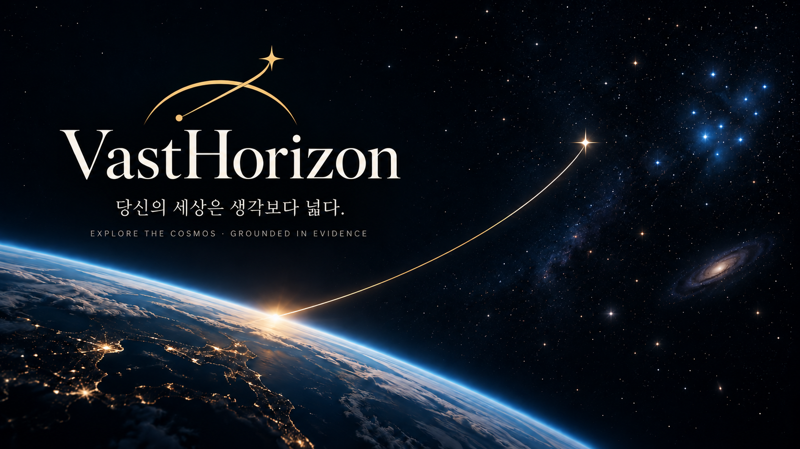
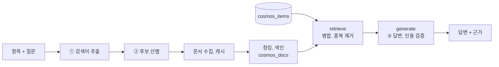
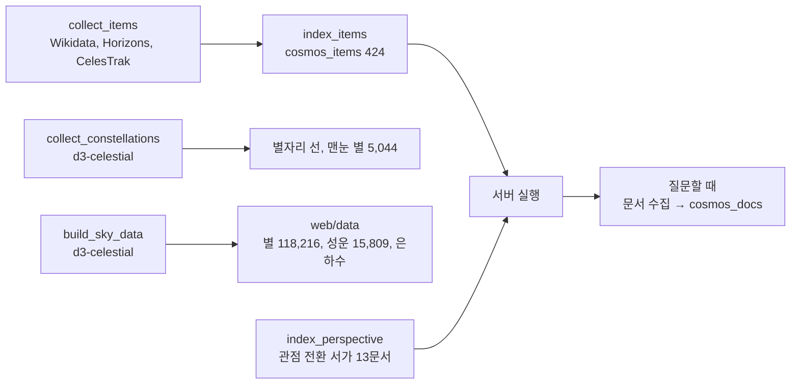

<p align="center">
  <picture>
    
  </picture>
</p>
<p align="center">
<em><b>VastHorizon(Vast + Horizon):</b> RAG 기반 우주 지식 서비스</em>
</p>
<p align="center">


</p>

---

<p align="center">
  
</p>

> **당신의 세상은 생각보다 넓습니다.**
> 세상이 좁게 느껴질 땐 고개를 들어보세요.

3D 하늘에서 천체를 고르면 **수집한 문서에 근거해서만** 답하는 우주 지식 서비스입니다.
바라본 천체가 멀수록 '내 세상의 반지름'이 지평선(4.7km)에서 우주 끝으로 넓어집니다.

SSAFY AI 코어 프로젝트 2, RAG 기반 도메인 지식 서비스, 2026 -10-21 ~ 2026-10-23


---

## 결과 한눈에

| 항목 | 결과 |
|---|---|
| 항목 메타데이터 | **424건**, 5개 그룹 (태양계 32, 인류의 발자취 100, 별 94, 메시에 110, 별자리 88) |
| 외부 문서 | 한국어 위키백과 + NASA NSSDCA, 질문할 때 수집, 657청크 (작성 시점) |
| 필수 기능 | F2001 ~ F2012 **모두 통과** |
| 심화 기능 | F2013 ~ F2016 **4개 모두 구현, 통과** |
| RAG 전후 비교 | 대표 8문항, 실행 1회 수동 판정: RAG 맞음 6, 확인 불가 2, **틀린 답 0**, 인용한 주장은 모두 근거와 일치 |
| 하늘 | 실제 별 118,216개 (확대하면 12등급대까지), 성운과 성단과 은하 15,809개, 은하수. 아무 별이나 눌러 담기 |
| 테스트 | Python 359, JavaScript 35, 브라우저 점검 25: **모두 통과** |

---

## 무엇을 하나

| 근거와 함께 답합니다 | 모르면 모른다고 합니다 |
|---|---|
|  |  |
| 사실 문장마다 `[근거 N]`. 인용된 근거만 원문 링크와 함께 | 문서에 없으면 "제공된 문서에서는 확인되지 않습니다" |

| 빛의 편지 | 마음 한 줄 (관점 전환) |
|---|---|
|  |  |
| 지금 보이는 별빛이 출발한 해와, 그해 지구의 기록 | 마음 곁에 우주의 사실 하나: 지어낸 위로 대신 |

| 오늘 밤 나의 하늘 | 조건 탐색 |
|---|---|
|  |  |
| 내 위치, 시각에 실제로 보이는 별자리, 행성 | "맨눈으로 볼 수 있는 은하"처럼 확인 가능한 조건으로 |

---

## 기능

### 필수 (F2001 ~ F2012)

| 번호 | 기능 | VastHorizon |
|---|---|---|
| F2001, F2002 | 항목 메타데이터 적재, 색인 | 424건 → `cosmos_items` (항목당 1청크, ID = Wikidata QID) |
| F2003, F2004 | 검색어 추출, 문서 수집 | 프롬프트 ① 검색어 → 위키 검색 → 프롬프트 ② 제목, 요약으로 선별. 항목 자체 문서는 항상 포함 |
| F2005 | 외부 문서 색인 | `cosmos_docs`, 1,000자 / 겹침 200자, 위키는 절 단위로 자름 |
| F2006 ~ F2008 | 검색, 답변, 근거 표시 | LangGraph `retrieve → generate`, 인용 검증, 인용된 근거만 표시 |
| F2009 | 항목 선택, 질의응답 | 3D 하늘, 천체 목록, 항목별 대화 분리 |
| F2010 | 도메인 특화 | 빛의 편지, 별자리 펼치기, 오늘 밤 나의 하늘, 관점 전환 |
| F2011 | 조건 탐색 | 자연어 → 메타데이터 필터 + 의미 검색 → 선별 |
| F2012 | 진행 상태, 안내 | 단계별 진행, 키 없음 / 색인 없음 안내 |

### 심화 (F2013 ~ F2016)

| 번호 | 기능 | 결과 |
|---|---|---|
| F2013 | 프론트엔드 직접 구현 | HTML, CSS, JS + Three.js 3D 하늘, FastAPI와 분리 |
| F2014 | MMR 검색 | 설정으로 전환, Streamlit에서 유사도와 나란히 비교 → 사실 질문은 유사도가 낫다고 판단해 기본값 유지 |
| F2015 | RAG 전후 비교 | 근거 없는 답과 나란히 8문항 → [05](docs/05_rag_comparison.md) |
| F2016 | 여러 출처 결합 | 위키백과 + NASA (영문), 근거마다 출처 종류 표시 |

---

## RAG 전후 비교 (F2015)

| 기준 | RAG 없이 | RAG |
|---|---|---|
| 사실 정확성 | 그럴듯하지만 수치가 뭉뚱그려짐 ("16세기 말", "2008년쯤") | 정확한 수치 (**1587년 무렵**, **2008년 2월 20일**), 오늘 기준 값 |
| 근거 제시 | 0회 | 모든 문항 1~5회 |
| 모르면 모른다고 | 0문항: "약 15광년" 단정 | 2문항: 근거에 있는 부분만 |

> 판정 범위: 실행 1회, 8문항, 사람이 주장과 근거를 직접 대조했습니다. 서비스의 자동 검사는 **인용 형식**(번호가 근거 목록에 있는지)까지만 확인합니다. 인용 없는 문장은 2문항에서 나왔습니다 ([05 §2-1](docs/05_rag_comparison.md)).
>
> 최신 모델은 근거 없이도 아는 것이 많았습니다. RAG의 가치는 정답률보다 **검증할 수 있는 근거, 정확한 수치, 최신 값, 정직함**에서 드러났습니다.

---

## 파이프라인



| 결정 | 값 | 이유 |
|---|---|---|
| 청크 | 1,000자 / 겹침 200자 | 위키 한 절 ≈ 근거 하나. 500자는 문단이 갈라지고 2,000자는 절이 섞임 |
| Top-k | 유사도 6 | 사실 질문에 필요한 절이 빠짐없이 들어옴. 10이면 먼 절이 섞임 |
| 근거 1 | 항목 메타데이터 (검색 없이 항상) | 거리, 날짜 같은 핵심 사실을 항상 근거로 |

자세한 설계와 측정은 [03. RAG 파이프라인 설계문서](docs/03_rag_pipeline_design.md)에 정리했습니다.

---

## 데이터 준비와 색인



| 단계 | 명령 |
|---|---|
| 1. 설치, 환경 | `pip install -r requirements.txt`, `.env`에 `GMS_KEY` |
| 2. 항목 수집, 색인 | `python -m scripts.collect_items` → `python -m scripts.index_items` |
| 3. 서가 색인, 시연 문서 | `python -m scripts.index_perspective`, `python -m scripts.index_docs --demo` |
| 4. 실행 | `uvicorn vasthorizon.api.app:app --port 8000` → http://localhost:8000 |
| 검증 페이지 | `streamlit run app/streamlit_app.py` |

자세한 설치, 실행, 옵션은 [부록 A. 설치, 실행 안내](docs/appendix_a_setup_guide.md)에 있습니다.

---

## 출처와 이용 조건

| 출처 | 쓰임 | 이용 조건 |
|---|---|---|
| [Wikidata](https://www.wikidata.org/) | 항목 메타데이터 | CC0 1.0 |
| [한국어 위키백과](https://ko.wikipedia.org/) | 외부 문서, 천체 소개 | CC BY-SA 4.0 |
| [NASA NSSDCA](https://nssdc.gsfc.nasa.gov/) | 탐사선 미션 설명 | 미국 정부 저작물 (공개) |
| [JPL Horizons](https://ssd.jpl.nasa.gov/horizons/) | 태양계 천체, 탐사선 위치 | 미국 정부 저작물 (공개) |
| [CelesTrak SATCAT](https://celestrak.org/satcat/) | 위성 궤도, 운용 상태 | 무료 공개, 출처 표기 |
| [d3-celestial](https://github.com/ofrohn/d3-celestial) | 히파르코스 별, 성운과 성단과 은하, 은하수 윤곽, 별자리 선 | BSD-3-Clause |
| [three.js](https://threejs.org/) r170, [Lucide](https://lucide.dev/) | 3D 화면, 아이콘 | MIT, ISC |

근거마다 원문 링크를 달고, 화면 하단에 출처를 표시합니다.

---

## 기술

| 영역 | 사용 |
|---|---|
| 언어 | Python **3.11 이상** (3.12.10, 3.11.9에서 검증), JavaScript |
| LLM | SSAFY GMS: `gpt-6-luna`, `text-embedding-3-small` |
| RAG | LangChain, LangGraph, Chroma |
| 서버 | FastAPI, SSE, Pydantic |
| 화면 | HTML, CSS, JavaScript, Three.js / 검증 페이지 Streamlit |

```
vasthorizon/
  data/       항목 수집, 색인 텍스트, 도메인 표현
  collect/    외부 문서 수집 (프롬프트 ① ②), 캐시
  store/      청킹, Chroma 색인, 검색
  rag/        프롬프트, 검색 병합, LangGraph, 인용 검증
  features/   빛의 편지, 펼치기, 하늘, 관점 전환, 조건 탐색, 비교
  api/        FastAPI
web/          3D 화면          app/   Streamlit 검증 페이지
scripts/      수집, 색인, 비교 스크립트          tests/   테스트
```

---

## 문서

| 문서 | 내용 |
|---|---|
| [01. 기획안](docs/01_project_plan.md) | 컨셉, 사용자, 기능 기획 |
| [02. 요구사항 정의서](docs/02_requirements.md) | 도메인 조건 근거, F2001 ~ F2016, NF2001 ~ NF2007 |
| [03. RAG 파이프라인 설계문서](docs/03_rag_pipeline_design.md) | 컬렉션, 수집, 청킹, 검색, 프롬프트, 문제와 해결 |
| [04. 검증 결과](docs/04_verification.md) | 확인 항목별 결과 화면, 대조표, 테스트, 체크리스트 |
| [05. RAG 전후 품질 비교](docs/05_rag_comparison.md) | F2015: 8문항 나란히 |
| [부록 A. 설치, 실행 안내](docs/appendix_a_setup_guide.md) | 명령, 옵션, 설정 |
