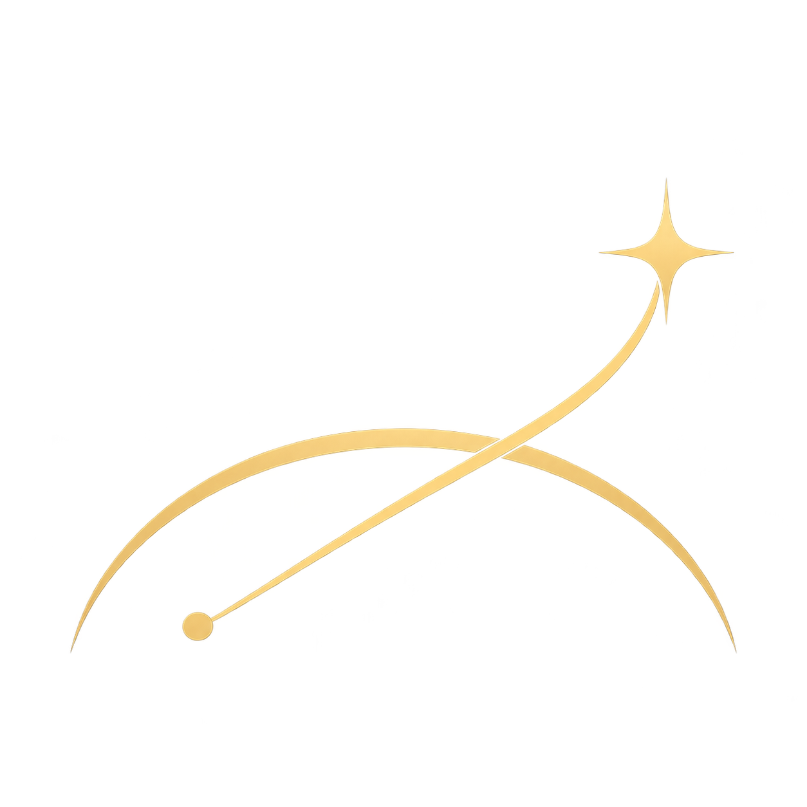
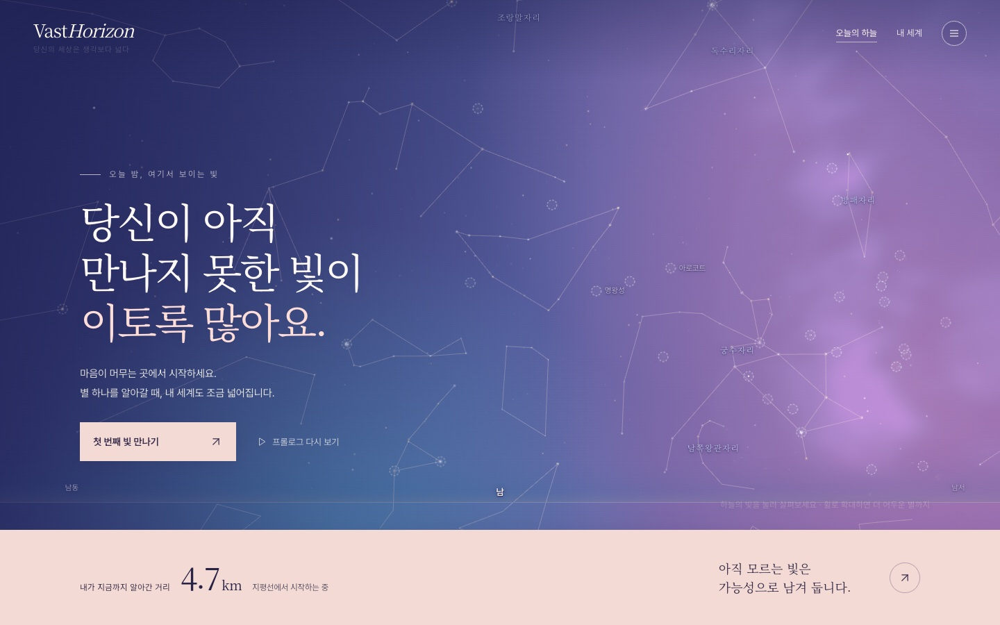
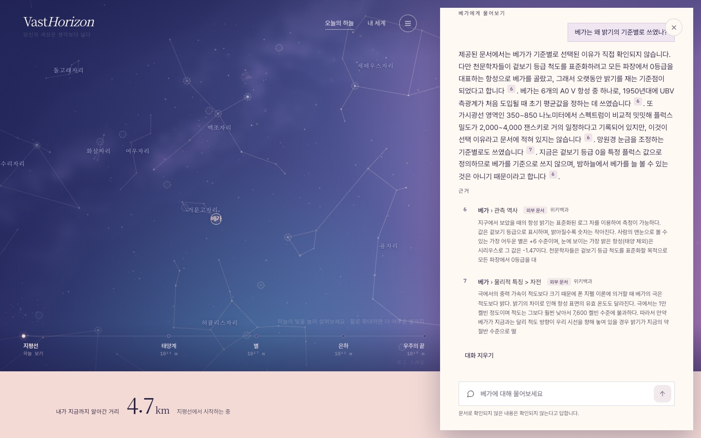
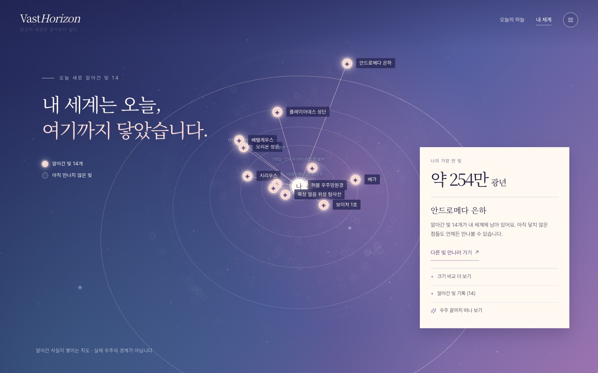
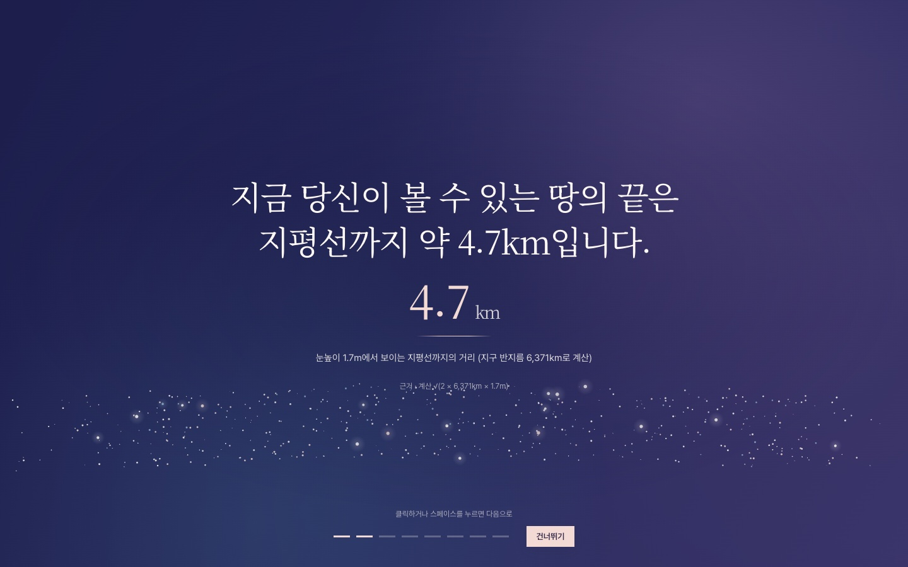
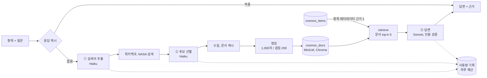

<p align="center">
  <picture>
    
  </picture>
</p>
<p align="center">
<em><b>VastHorizon(Vast + Horizon):</b> RAG 기반 우주 지식 서비스</em>
</p>
<p align="center">


</p>

---

<p align="center">
  
</p>

> **당신의 세상은 생각보다 넓습니다.**
> 세상이 좁게 느껴질 땐 고개를 들어보세요.

3D 하늘에서 천체를 고르면 **수집한 문서에 근거해서만** 답하는 우주 지식 서비스입니다.
천체를 하나씩 알아갈 때마다 내 세계에 빛이 더해지고, 가장 먼 빛은 지평선(4.7km)에서 우주 끝까지 닿습니다.

---

## 이 서비스가 건네고 싶은 것

세상이 유난히 좁고 답답하게 느껴지는 날이 있습니다. 하루가 작은 방 안에서만 맴도는 것 같고, 내가 아는 세상이 이게 전부인 것 같은 날입니다.
VastHorizon은 그런 날을 위해 만들었습니다.

### 위로를 지어내지 않고, 사실로 위로합니다

"괜찮아요"라는 말은 따뜻하지만, 근거가 없으면 금방 흩어집니다. 그래서 이 서비스는 위로의 말을 지어내지 않습니다.

대신 누구나 확인할 수 있는 우주의 사실을 건넵니다. 모든 답은 수집한 문서에 근거하고, 문장마다 출처를 붙입니다.

문서로 확인되지 않는 것은 확인되지 않는다고 말합니다. 사실이기 때문에, 오늘 받은 위로를 내일 다시 꺼내 보아도 그대로입니다.

### 알아가는 만큼, 세상은 넓어집니다

처음 화면에서 당신의 세상은 눈앞의 지평선, 약 4.7km에서 시작합니다.

별 하나, 은하 하나를 읽고 "이 빛을 내 세계에 담기"를 누를 때마다 그 빛이 내 세계에 더해지고, 가장 먼 빛은 우주의 끝까지 닿을 수 있습니다.

알아간 천체는 하늘과 목록과 지도에서 같은 살구색 표식(✦)으로 표시되고, 아직 만나지 않은 천체는 빈 점선 원으로 흐리게 남아 있습니다. 이들도 앞으로 알아갈 수 있는 가능성입니다.
(이것은 배움에 대한 은유입니다. 천체의 실제 상태가 정해지지 않았다는 과학적 주장이 아닙니다.)

### 고개를 들면 보이는 사실들

| 사실 | 근거 |
|---|---|
| 지금 보이는 안드로메다 은하의 빛은 약 250만 년 전에 출발해, 오늘 당신의 눈에 닿았습니다 | 위키백과 「안드로메다 은하」 |
| 우리 몸을 이루는 탄소와 산소 같은 원소는 별 속의 핵융합으로 만들어졌습니다. 당신은 별에서 왔습니다 | 위키백과 「항성 핵합성」 |
| 보이저 1호가 약 61억 km 밖에서 찍은 지구는 사진 속에서 0.12화소였습니다. 그 작은 점에 우리가 아는 모든 것이 있습니다 | 위키백과 「창백한 푸른 점」 |
| 관측 가능한 우주는 반지름 약 465억 광년의 구이고, 그 중심에는 언제나 바라보는 사람이 있습니다 | 위키백과 「관측 가능한 우주」 |

오늘 당신의 세상이 작게 느껴졌다면, 그건 아직 알아갈 빛이 그만큼 많이 남아 있다는 뜻일지도 모릅니다.
고개를 들어, 첫 번째 빛을 바라보세요. **당신의 세상은 생각보다 넓습니다.**

> 이 서비스는 전문 심리상담을 대신하지 않습니다. 마음 한 줄에 위기를 뜻하는 표현이 들어오면, 답 대신 도움을 받을 수 있는 상담 창구를 먼저 안내합니다.

---

## 개요

- **3D 하늘에서 천체 고르기**: 실제 별 11만여 개와 성운, 성단, 은하, 은하수가 떠 있는 하늘에서 카탈로그 천체 424개나 아무 별을 눌러 그 천체의 서랍을 엽니다.
- **문서에 근거한 답**: 질문이 들어오면 한국어 위키백과와 NASA 문서를 모아 색인하고, 사실 문장마다 `[근거 N]`과 원문 링크를 붙입니다. 문서에 없으면 확인되지 않는다고 답합니다.
- **내 세계 지도**: 알아간 천체가 '나'에게 이어지는 선으로 쌓이고, 가장 먼 빛까지의 거리가 내 세계의 반지름이 됩니다.
- **빛의 편지, 관점 전환, 조건 탐색, 오늘 밤 하늘**: 별빛이 출발한 해의 지구 기록, 마음 한 줄 곁의 우주 사실, "맨눈으로 볼 수 있는 은하" 같은 조건 검색, 내 위치와 시각의 하늘을 보여 줍니다.
- **받은 편지 보관과 링크·이미지 공유**: 받은 빛의 편지와 마음 한 줄은 이 기기의 보관함에 남고, 링크를 복사하거나 카드 이미지로 저장해서 다른 사람에게 보낼 수 있습니다. 마음 한 줄에 적은 문장은 공유 카드에 담기지 않습니다.
- **태양계 천체 근접 뷰**: 태양계 천체 32개는 탐사와 관측으로 알려진 특징을 바탕으로 그린 3D 모습(상상도)으로 가까이서 볼 수 있습니다.

| 첫 하늘 | 읽기 카드: 답변과 근거 |
|---|---|
|  |  |

| 내 세계 | 프롤로그 |
|---|---|
|  |  |

---

## 시작하기

Python 3.11 이상과 Claude API 키가 필요합니다. `.env`에 `CLAUDE_API_KEY`와 `WIKI_CONTACT`(연락처 이메일)를 적은 뒤 실행합니다.

```bash
python -m venv .venv && source .venv/bin/activate
pip install -r requirements-deploy.txt
cp .env.example .env                          # CLAUDE_API_KEY, WIKI_CONTACT 채우기
export VH_CONFIG=config.deploy.toml
python -m scripts.deploy_init                 # 항목, 관점 전환 서가 색인 (첫 실행에 몇 분)
uvicorn vasthorizon.api.app:app --port 8000   # http://localhost:8000
```

데이터 준비 스크립트와 API, 설정값은 [docs/setup.md](docs/setup.md)에서 설명합니다.

---

## 구성

```
vasthorizon/
  data/       항목 수집, 색인 텍스트, 도메인 표현, 성군 별칭
  collect/    외부 문서 검색어 추출, 후보 선별, 수집, 캐시
  store/      청킹, Chroma 색인, 검색
  rag/        프롬프트, 근거 병합, LangGraph, 인용 검증
  features/   빛의 편지, 별자리 펼치기, 하늘, 관점 전환, 조건 탐색
  api/        FastAPI, 호출 한도
web/          3D 화면 (HTML, CSS, JavaScript, three.js)
scripts/      수집, 색인, 배포 준비 스크립트
deploy/       개인 서버 배포용 compose, 배포 스크립트
tests/        Python, JavaScript 테스트
```

| 영역 | 기술 |
|---|---|
| 서버 | FastAPI, SSE, Pydantic (Python 3.11 이상) |
| RAG | LangChain, LangGraph, Chroma |
| 임베딩 | fastembed `paraphrase-multilingual-MiniLM-L12-v2` (서버 안 로컬 계산) |
| LLM | Claude API (`claude-sonnet-5-5`) |
| 화면 | three.js r170, Lucide 아이콘, Pretendard, Noto Serif KR |

수집부터 인용 검증까지 이어지는 설계와, 각 설정값을 정한 이유는 [docs/architecture.md](docs/architecture.md)에 정리했습니다.

---

## RAG 아키텍처



| 단계 | 하는 일 | 모델, 도구 |
|---|---|---|
| 검색어 추출 | 질문을 위키 제목 같은 검색어로 바꿉니다(최대 4개) | Haiku |
| 후보 선별 | 제목과 요약만 보고 답이 있을 문서를 고릅니다(최대 4개) | Haiku, 위키백과, NASA |
| 청킹, 색인 | 문서를 1,000자(겹침 200)로 잘라 `cosmos_docs`에 넣습니다 | LangChain 분할기, MiniLM, Chroma |
| 검색 | 항목 메타데이터를 근거 1로 고정하고 문서 상위 6개를 더합니다 | Chroma 유사도 검색 |
| 답변, 인용 검증 | 근거만으로 답하고 `[근거 N]`을 검사해 어긋나면 한 번 다시 생성합니다 | Sonnet, LangGraph |
| 조건 탐색 규칙 경로 | 동의어 표로 질의가 해석되면 LLM 없이 결과를 정합니다 | `explore_rules.py` |
| 응답 캐시 | 같은 요청에는 저장한 응답을 돌려줍니다 | 파일 캐시(`cache.py`) |

항목 메타데이터는 검색 결과와 상관없이 항상 근거 1로 들어가므로, 문서 검색이 실패해도 이 근거만으로 답할 수 있습니다. 답변은 근거 번호를 검증하고, 문서에서 답을 찾지 못하면 "제공된 문서에서는 확인되지 않습니다"라고 답합니다. 조건 탐색은 질의를 먼저 규칙으로 해석하며, 규칙만으로 해석되면 LLM을 부르지 않습니다. 같은 요청은 응답 캐시로 처리하고, 추정 비용이 하루 예산을 넘으면 새 호출을 막습니다.

컬렉션 구성, 청크 크기를 정한 근거, 프롬프트 규칙은 [docs/architecture.md](docs/architecture.md)에 있습니다.

---

## 배포

현재는 정적 Nginx 서버(화면)와 API 컨테이너 서버를 나눈 개인 서버 두 대에 올려 두고, GitHub Actions가 ARM 이미지를 만들어 차례로 배포합니다. 임베딩 모델 실측 결과와 그 밖의 배포 세부는 [docs/deploy.md](docs/deploy.md)의 "임베딩 모델 선택과 실측" 절에 있습니다.

---

## 출처와 이용 조건

| 출처 | 쓰임 | 이용 조건 |
|---|---|---|
| [Wikidata](https://www.wikidata.org/) | 항목 메타데이터 | CC0 1.0 |
| [한국어 위키백과](https://ko.wikipedia.org/) | 외부 문서, 천체 소개 | CC BY-SA 4.0 |
| [NASA NSSDCA](https://nssdc.gsfc.nasa.gov/) | 탐사선 미션 설명 | 미국 정부 저작물 (공개) |
| [JPL Horizons](https://ssd.jpl.nasa.gov/horizons/) | 태양계 천체, 탐사선 위치 | 미국 정부 저작물 (공개) |
| [CelesTrak SATCAT](https://celestrak.org/satcat/) | 위성 궤도, 운용 상태 | 무료 공개, 출처 표기 |
| [d3-celestial](https://github.com/ofrohn/d3-celestial) | 히파르코스 별, 성운과 성단과 은하, 은하수 윤곽, 별자리 선 | BSD-3-Clause |
| [NASA 과학시각화 스튜디오 CGI Moon Kit](https://svs.gsfc.nasa.gov/4720) | 달 표면 지도 (LRO) | 미국 정부 저작물 (공개), 출처 표기 |
| [NASA Hubble's Messier Catalog](https://science.nasa.gov/mission/hubble/science/explore-the-night-sky/hubble-messier-catalog/) | 메시에 천체 사진 89장 | NASA 자료는 공개, ESA 등 함께 표기된 사진은 그 기관 조건(대개 CC BY 4.0). 사진마다 출처 표기 |
| [NASA 3D Resources](https://github.com/nasa/NASA-3D-Resources) | 위성, 탐사선 3D 모델 4개 | 저작권 없음 (NASA 미디어 이용 지침) |
| [JPL 행성 근사 궤도 요소](https://ssd.jpl.nasa.gov/planets/approx_pos.html) | 그날의 행성 위치 계산 | 미국 정부 저작물 (공개) |
| [three.js](https://threejs.org/) r170, [Lucide](https://lucide.dev/), [Draco](https://github.com/google/draco) | 3D 화면, 아이콘, 모델 압축 해제 | MIT, ISC, Apache-2.0 |

근거마다 원문 링크를 달고, 화면 하단에 출처를 표시합니다.

---

## 문서

| 문서 | 내용 |
|---|---|
| [설계](docs/architecture.md) | 컬렉션, 문서 수집 흐름, 청킹과 검색 설정, 인용 검증, 기능별 데이터 출처 |
| [설치와 실행](docs/setup.md) | 설치, 색인, 데이터 준비 스크립트, API, 설정 |
| [배포](docs/deploy.md) | Docker, 개인 서버 두 대 구성, GitHub Actions, 호출 한도, 임베딩 모델 실측 |
| [디자인 제안](design-proposal/README.md) | 화면 디자인 시안과 디자인 적용 명세 |
