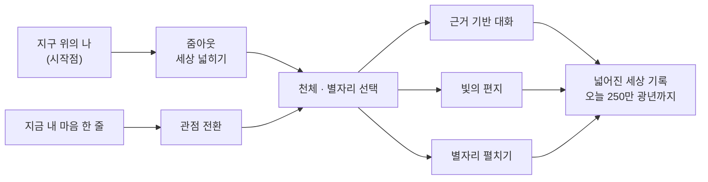
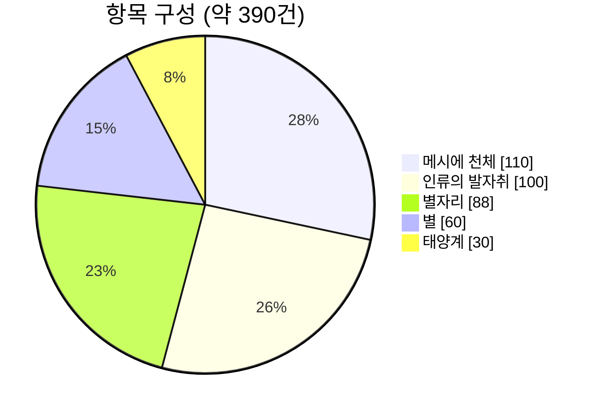
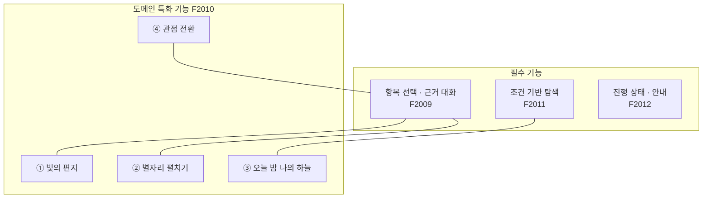
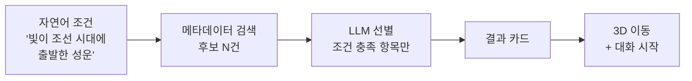
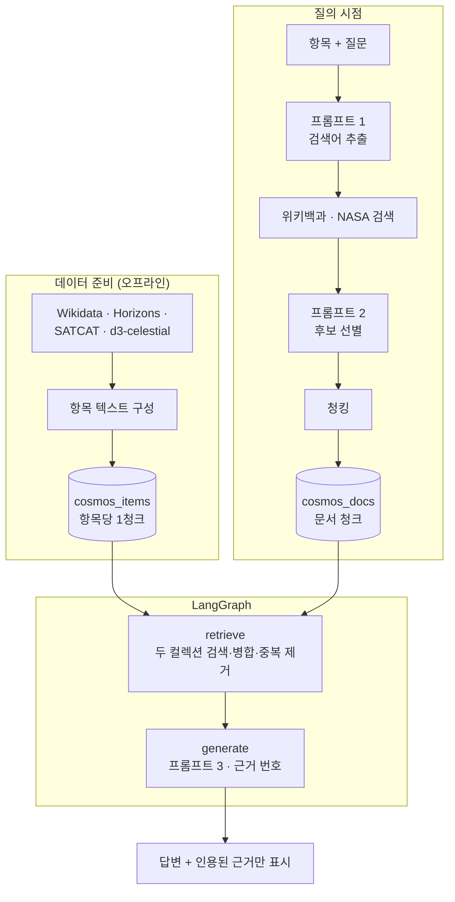
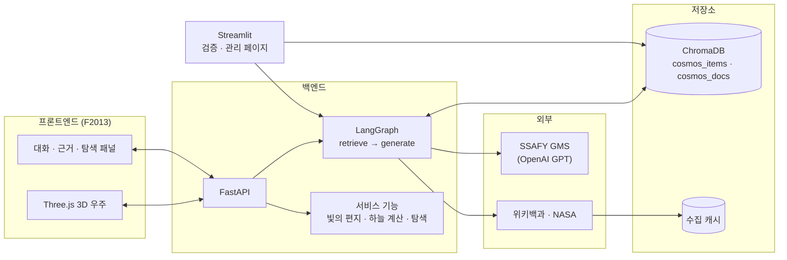
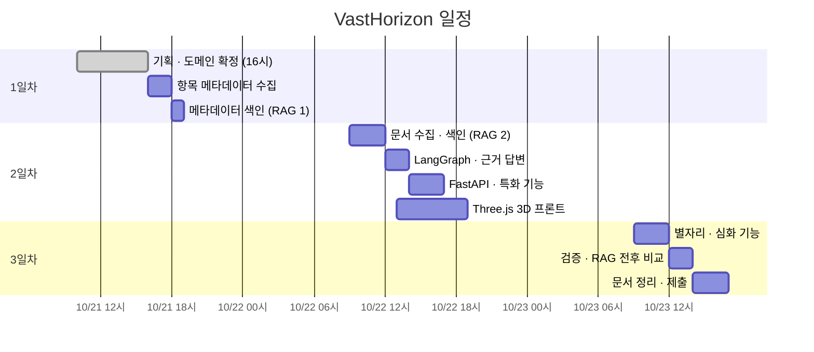

# VastHorizon 기획안

> **Vast + Horizon** — 당신의 세상은 생각보다 넓다.

RAG 기반 도메인 지식 서비스 · AI 코어 프로젝트 2회차
작성일: 2026-10-21 (1일차)

---

## 목차

1. [한눈에 보기](#1-한눈에-보기)
2. [기획 배경과 핵심 원칙](#2-기획-배경과-핵심-원칙)
3. [사용자 여정](#3-사용자-여정)
4. [도메인 확정 근거](#4-도메인-확정-근거)
5. [항목 구성](#5-항목-구성)
6. [데이터·문서 출처와 이용 조건](#6-데이터문서-출처와-이용-조건)
7. [근거가 필요한 질문](#7-근거가-필요한-질문)
8. [서비스 기능 설계](#8-서비스-기능-설계)
9. [3D 우주 시각화 설계](#9-3d-우주-시각화-설계)
10. [RAG 파이프라인 개요](#10-rag-파이프라인-개요)
11. [시스템 구조](#11-시스템-구조)
12. [요구사항 대응표](#12-요구사항-대응표)
13. [안전과 윤리](#13-안전과-윤리)
14. [일정](#14-일정)
15. [리스크와 대응](#15-리스크와-대응)
16. [결정 사항과 남은 확인](#16-결정-사항과-남은-확인)

---

## 1. 한눈에 보기

| 구분 | 내용 |
|---|---|
| 서비스명 | **VastHorizon** |
| 한 줄 소개 | 지구 위 '나'에서 출발해 우주 끝까지, 근거와 함께 세상을 넓혀가는 3D 우주 지식 서비스 |
| 도메인 | 우주 — 천체 · 별자리 · 인류의 우주 탐사 |
| 항목 수 | 약 **390건** (5개 그룹) |
| 외부 문서 | 한국어 위키백과 + NASA NSSDCA |
| 핵심 경험 | 3D 우주 탐험 · 별자리 · 빛의 편지 · 관점 전환 |
| 위험 도메인 | 해당 없음 (단, 정서 기능에 안내 문구 적용) |

### 세 가지 키워드

```
  넓히다            잇다              기대다
  ─────            ─────            ─────
  나 → 지구 →       우주의 사실과       지어낸 위로가 아닌
  태양계 → 은하     나의 삶을 연결      근거 있는 사실로 위로
```

---

## 2. 기획 배경과 핵심 원칙

### 배경

스트레스가 쌓이면 세상이 좁게 느껴진다.
하지만 우리가 사는 세상은 400km 위의 우주정거장, 250만 광년 밖의 은하까지 이어져 있다.

VastHorizon은 이 연결을 **눈으로 보고, 근거로 확인하는** 경험을 만든다.

### 핵심 원칙

> **위로를 지어내지 않는다. 사실로 위로한다.**

| 원칙 | 의미 | RAG 과제와의 연결 |
|---|---|---|
| 사실로 위로 | 모든 문장은 검색된 근거에서 나온다 | F2007 근거 기반 답변 |
| 출처를 보여준다 | 감성 문장에도 `[근거 N]`을 붙인다 | F2008 근거 표시 |
| 모르면 모른다 | 문서에 없으면 확인되지 않는다고 답한다 | F2007 추측 금지 |
| 나에서 출발 | 모든 거리는 '지구 위의 나'를 기준으로 잰다 | 3D 시각화 · 특화 기능 |

감성 서비스이지만, 그래서 더 **근거가 필수**다.
지어낸 위로는 틀린 사실을 퍼뜨리기 쉽기 때문이다.

---

## 3. 사용자 여정



### 장면별 흐름

1. **출발** — 화면은 지구 위 작은 점 "당신"에서 시작한다.
2. **넓히기** — 스크롤하면 ISS → 달 → 태양 → 보이저 1호 → 별 → 은하로 시야가 넓어진다.
3. **선택** — 천체나 별자리를 누르면 카메라가 그곳으로 날아간다.
4. **대화** — 그 항목에 대해 묻고, 근거와 함께 답을 받는다.
5. **기록** — 다녀간 곳이 궤적으로 남는다. "오늘 당신의 세상은 250만 광년까지 넓어졌습니다."

---

## 4. 도메인 확정 근거

> 명세서 1.2절 · 2.1절의 세 조건에 대한 확인 결과다.
> 수치는 2026-10-21 실제 API 조회로 확인했다.

| 조건 | 요구 | VastHorizon | 충족 |
|---|---|---|:---:|
| ① 항목 메타데이터 | 이름·속성을 가진 항목 약 100건 이상, 출처 기록 | 약 390건 · Wikidata 외 4개 출처 ([5장](#5-항목-구성)) | ✅ |
| ② 외부 문서 출처 | 항목마다 설명 문서, 이용 조건 기록 | 한국어 위키백과 (항목별 문서 연결) + NASA NSSDCA ([6장](#6-데이터문서-출처와-이용-조건)) | ✅ |
| ③ 근거가 필요한 질문 | 근거 없이 답하면 틀리는 질문 3개 이상 | 8개 선정 ([7장](#7-근거가-필요한-질문)) | ✅ |
| 위험 도메인 여부 | 건강·금융이면 면책 안내 | 해당 없음. 정서 기능에는 자체 안내 적용 ([13장](#13-안전과-윤리)) | ✅ |

### 사전 조회 결과

| 확인 대상 | 결과 |
|---|---|
| 메시에 천체 (한국어 위키 문서 있음) | 110 / 110건 · 적경·적위 110건 · 거리 109건 |
| IAU 별자리 (한국어 위키 문서 있음) | 86 / 88건 · 약어 86건 · 면적 85건 |
| 인공위성 + 탐사선 (한국어 위키 문서 있음) | 317건 · 발사일 272건 · COSPAR ID 251건 |
| JPL Horizons API | 보이저 1호의 2026-10-21 위치 벡터 수신 성공 |
| CelesTrak SATCAT | 아리랑 1호 궤도·운용 상태 수신 성공 |
| d3-celestial 별자리 데이터 | 별자리 선·경계·6등성 별 파일 수신 성공 |

---

## 5. 항목 구성

### 그룹별 구성

| 그룹 | 예시 | 건수 | 메타데이터 출처 | 3D 위치 |
|---|---|---:|---|---|
| ☀️ 태양계 | 행성, 왜행성, 주요 위성, 혜성 | 약 30 | Wikidata | JPL Horizons 실제 위치 |
| 🚀 인류의 발자취 | 보이저, 제임스 웹, ISS, 아리랑, 다누리 | 약 100 | Wikidata · CelesTrak | 궤도 고도 / Horizons |
| ⭐ 별 | 시리우스, 베가, 베텔게우스, 북극성 | 약 60 | Wikidata · d3-celestial | 적경·적위·거리 |
| 🌌 메시에 천체 | 오리온 성운, 플레이아데스, 안드로메다 | 110 | Wikidata | 적경·적위·거리 |
| ✨ 별자리 | IAU 88개 별자리 | 88 | Wikidata · d3-celestial | 천구 위 선·경계 |
| **합계** | | **약 390** | | |



### 항목 1건의 색인 텍스트 (F2001)

사용자가 **무엇으로 찾을지**를 기준으로 속성을 묶는다.

| 그룹 | 색인 텍스트에 넣는 속성 |
|---|---|
| 공통 | 한국어 이름 · 영문/학술명 · 그룹 · 종류 · 지구로부터 거리 · 빛이 걸리는 시간 |
| 천체 | 별자리 · 겉보기 등급 · 맨눈 관측 여부 · 분광형/천체 유형 |
| 인류의 발자취 | 국가 · 운영기관 · 발사일 · 발사체 · 목적지 · 운용 상태 |
| 별자리 | 라틴명 · 약어 · 면적 · 대표 별 · 관측 계절 · 황도 별자리 여부 |

예시 — 플레이아데스:

```
[메시에 천체] 플레이아데스 (M45, Pleiades)
종류: 산개성단 · 별자리: 황소자리 · 겉보기 등급: 1.6 (맨눈 관측 가능)
지구로부터 거리: 약 444광년 · 지금 보는 빛은 약 1580년대에 출발
```

> 거리와 "빛의 출발 연도"를 텍스트에 넣는다.
> 그래야 "조선 시대에 출발한 빛" 같은 조건 검색이 걸린다.

---

## 6. 데이터·문서 출처와 이용 조건

### 항목 메타데이터 출처

| 출처 | 용도 | 형식 | 이용 조건 |
|---|---|---|---|
| Wikidata | 항목 목록 · 기본 속성 · 한국어 위키 연결 | SPARQL → JSON | CC0 1.0 |
| JPL Horizons (NASA) | 태양계 천체 · 심우주 탐사선 현재 위치 | REST → 텍스트 | 미국 정부 저작물 (공개) |
| CelesTrak SATCAT | 인공위성 궤도 · 운용 상태 · 재진입일 | REST → JSON | 무료 공개 · 출처 표기 (세부 조건 확인 예정) |
| d3-celestial | 별자리 선 · 경계 · 별 좌표 | GeoJSON | BSD-3-Clause (저작권 고지 유지) |
| Stellarium 한국 별자리 | 조선 전통 별자리 선 (선택 레이어) | JSON | GPL v2 (고지 · 소스 공개 조건 준수) |

### 외부 문서 출처

| 출처 | 문서 | 출처 종류 표기 | 이용 조건 |
|---|---|---|---|
| 한국어 위키백과 | 항목별 문서 · 관련 개념 · 연도 문서 | `위키백과` | CC BY-SA 4.0 (출처·라이선스 표기) |
| NASA NSSDCA | 탐사선 · 위성 미션 설명 (영문) | `NASA` | 미국 정부 저작물 (공개) |

### 외부 API 예절 (NF2006)

- 위키백과 · Wikidata 요청에는 `앱이름/버전 (연락처)` 형식의 User-Agent를 붙인다.
- 호출 사이에 간격을 두고, 실패 시 지수 백오프로 재시도한다.
- 이미 수집한 검색어는 캐시에서 읽는다 (NF2002).

---

## 7. 근거가 필요한 질문

> 근거 없이 답하면 **틀리기 쉬운** 질문이다.
> F2015 (RAG 전후 비교)의 대표 질문으로도 쓴다.

| # | 질문 | 근거 없이 답할 때의 위험 | 근거 |
|:-:|---|---|---|
| 1 | 아리랑 1호는 지금도 지구를 돌고 있나? | "이미 추락했다"로 단정하기 쉬움. 실제로는 임무 종료 후 궤도에 남아 있음 | SATCAT · 위키 |
| 2 | 제임스 웹 망원경은 허블처럼 지구를 도나? | 지구 궤도로 착각. 실제로는 약 150만 km 떨어진 L2 부근 | 위키 · NASA |
| 3 | 보이저 1호는 태양계를 벗어났나? | 기준(태양권계면 / 오르트 구름)에 따라 답이 다름을 놓침 | 위키 · Horizons |
| 4 | 지금 보는 플레이아데스의 빛은 언제 출발했나? | 거리 수치를 지어내면 연도까지 틀림 | Wikidata · 위키 |
| 5 | 오리온자리 별들은 서로 가까이 모여 있나? | "가깝다"고 답하기 쉬움. 실제 거리는 약 250~2,000광년으로 제각각 | Wikidata · 위키 |
| 6 | 내 생일에 태양은 정말 내 '별자리'에 있었나? | 점성술 날짜를 사실처럼 답함. 세차 운동으로 실제 위치가 어긋남 | 위키 (세차 운동) |
| 7 | 견우성과 직녀성은 실제로 얼마나 떨어져 있나? | 거리 수치를 지어내기 쉬움 | Wikidata · 위키 |
| 8 | 천상열차분야지도는 무엇을 담은 유물인가? | 제작 연대 · 별 개수를 틀리기 쉬움 | 위키 |

> 표의 "실제" 서술은 기획 단계의 예상이다.
> 최종 답변은 반드시 수집된 문서로 확인한다.

---

## 8. 서비스 기능 설계

### 8.1 기능 지도



### 8.2 도메인 특화 기능 (F2010)

#### ① 빛의 편지 ★ 대표 기능

> "지금 당신에게 닿은 이 빛이 출발했을 때, 지구에서는…"

| 항목 | 내용 |
|---|---|
| 입력 | 천체 1개 (또는 나이) |
| 계산 | 출발 연도 = 올해 − 거리(광년) |
| 근거 | 천체 거리 메타데이터 + 한국어 위키 **연도 문서** (예: `1582년`) |
| 출력 | 빛의 출발 시점 · 그때 지구의 사건 · 근거 목록 |

**확장 — 당신의 나이만큼 먼 별**

- 나이를 입력하면 "당신이 태어난 해에 출발해 지금 막 도착한 빛"의 별을 찾는다.
- 예: 25세 → 베가 (약 25광년)

#### ② 별자리 펼치기

> 별자리는 **지구에서만** 보이는 모양이다.

| 항목 | 내용 |
|---|---|
| 동작 | 천구 위 평면 별자리 → 실제 거리로 3D 펼침 애니메이션 |
| 근거 | 별자리 문서 + 구성 별의 거리 메타데이터 |
| 출력 | "오리온의 허리띠 세 별은 실제로 수백 광년씩 떨어져 있다 [근거 N]" |

#### ③ 오늘 밤 나의 하늘

| 항목 | 내용 |
|---|---|
| 입력 | 위치 (기본: 서울) · 날짜와 시각 |
| 계산 | 지평선 위에 뜬 별자리 · 행성 계산 |
| 근거 | 별자리 문서 (관측 계절 · 대표 별 · 신화) |
| 레이어 | 서양 별자리 (IAU) ↔ 조선의 별자리 (천상열차분야지도) 전환 |

#### ④ 관점 전환

> 지금의 마음 한 줄을, 우주의 사실과 잇는다.

| 항목 | 내용 |
|---|---|
| 입력 | 마음 한 줄 (자유 입력) 또는 감정 버튼 |
| 동작 | 감정과 이어지는 우주의 사실을 검색하고, 근거와 함께 관점을 넓혀준다 |
| 근거 예 | 창백한 푸른 점 (1990) · 우주비행사의 조망 효과 · 별에서 온 원소 · 같은 별을 본 옛사람들 |
| 금지 | 진단 · 조언 · 근거 없는 위로 문장 |
| 안전 | 위기 표현 감지 시 상담 안내를 먼저 표시 ([13장](#13-안전과-윤리)) |

### 8.3 조건 기반 탐색 (F2011)



| 조건 예시 | 확인할 속성 |
|---|---|
| 사람이 만든 것 중 태양계 밖으로 나간 것 | 그룹 · 거리 |
| 빛이 조선 시대에 출발한 성운 | 종류 · 빛의 출발 연도 |
| 맨눈으로 볼 수 있는 은하 | 종류 · 겉보기 등급 |
| 겨울밤에 볼 수 있는 별자리 | 그룹 · 관측 계절 |
| "아주 멀고 고요한 곳" (감성 표현) | LLM이 거리 · 종류 같은 **검증 가능한 조건**으로 바꿔 선별 |

> 감성 표현도 받지만, 선별은 항상 사실 속성으로 한다.
> 취향 추천으로 흐르지 않게 하는 장치다.

---

## 9. 3D 우주 시각화 설계

### 9.1 거리 사다리

화면은 **로그 스케일**로 배치한다.
방향은 실제 하늘 방향(적경·적위)을 그대로 쓴다.

```
 나 ─── ISS ─── 달 ──── 태양 ──── 보이저 1호 ──── 프록시마 ──── 플레이아데스 ──── 은하 중심 ──── 안드로메다
 0     400km   1.3광초   8.3광분     약 1광일        4.2광년        약 444광년        약 2.6만 광년    약 250만 광년
 └──────────────────── 지구 · 태양계 ────────────────────┘└──────── 우리 은하 ────────┘└─ 은하 너머 ─┘
```

| 거리 고리 | 의미 |
|---|---|
| 1광초 | 달까지 |
| 1광분 | 태양까지 (8.3광분) |
| 1광일 | 인류가 만든 가장 먼 물체 |
| 1광년 ~ 1천 광년 | 밤하늘에 보이는 별들 |
| 100만 광년 이상 | 다른 은하 |

### 9.2 보기 모드

| 모드 | 화면 | 연결 기능 |
|---|---|---|
| 🌍 우주 지도 | 로그 스케일 3D 공간 · 전체 항목 배치 | 항목 선택 · 대화 |
| ✨ 천구 | 지구에서 올려다본 하늘 · 별자리 선과 경계 | 오늘 밤 나의 하늘 |
| 🔭 펼치기 | 별자리 별들을 실제 거리로 이동 | 별자리 펼치기 |
| 🏯 조선의 하늘 | 천상열차분야지도 별자리 레이어 | 서양 ↔ 조선 비교 |

### 9.3 화면 구성

```
┌──────────────────────────────────────────────────────────────┐
│  VastHorizon            [우주 지도|천구|펼치기]   오늘 2.5Mly 🧭 │
├────────────────────────────────────────┬─────────────────────┤
│                                        │  플레이아데스 (M45)    │
│                                        │  ─────────────────   │
│          3D 우주 (Three.js)             │  💬 대화              │
│                                        │  …[근거 1][근거 2]    │
│        ·  ✦        ·      ✦            │                     │
│     ✦      ●나          ·              │  📎 근거              │
│        ·        ✦     ·                │  [1] 플레이아데스·위키  │
│                                        │  [2] 1582년·위키      │
├────────────────────────────────────────┤                     │
│  🔍 조건 탐색  ✉️ 빛의 편지  🌙 마음 한 줄  │  [질문 입력……]  ▶    │
└────────────────────────────────────────┴─────────────────────┘
```

---

## 10. RAG 파이프라인 개요

> 상세 설계는 별도 문서 (RAG 파이프라인 설계문서)에서 다룬다.

### 10.1 흐름



### 10.2 컬렉션

| 컬렉션 | 내용 | 청크 ID | 주요 메타데이터 |
|---|---|---|---|
| `cosmos_items` | 항목 메타데이터 | `Wikidata QID` | 그룹 · 종류 · 거리 · 빛의 출발 연도 · 좌표 |
| `cosmos_docs` | 외부 문서 청크 | `항목ID:문서ID:순번` | 문서 제목 · 원문 URL · 출처 종류 · 항목 ID · 검색어 · 수집일 |

### 10.3 프롬프트 세 개

| 프롬프트 | 역할 | 출력 형식 |
|---|---|---|
| ① 검색어 추출 | "천문학 해설사" — 항목과 질문에서 검색어 추출. 항목 자체 문서는 항상 포함 | JSON 배열 |
| ② 후보 선별 | 제목·요약만 보고 색인할 문서 선택 | JSON (선택 ID 목록) |
| ③ 답변 생성 | 근거로만 답함 · 말투는 따뜻하게 · 근거 없으면 "확인되지 않음" | 본문 + `[근거 N]` |

### 10.4 검색 설정 (시작값)

| 설정 | 시작값 | 조정 방법 |
|---|---|---|
| 청크 크기 / 중복 | 1,000자 / 200자 | 설정 파일 |
| Top-k | 항목 1 + 문서 청크 6 | 설정 파일 |
| 검색 방식 | 유사도 (MMR 전환 가능) | 설정 파일 |

---

## 11. 시스템 구조



### 모듈 분리 (NF2005)

| 영역 | 책임 |
|---|---|
| 데이터 준비 | 항목 수집 · 색인 텍스트 구성 · 외부 문서 수집 (도메인 의존 코드는 여기에 모음) |
| Vector Store | 컬렉션 생성 · 청킹 · 임베딩 색인 |
| RAG 파이프라인 | LangGraph 노드 · 프롬프트 · 근거 번호 |
| 서비스 기능 | 빛의 편지 · 하늘 계산 · 조건 탐색 · 관점 전환 |
| API | 요청·응답 형식 정의 |
| UI | Three.js 프론트엔드 · Streamlit 검증 페이지 |

### 기술 스택

| 구분 | 사용 |
|---|---|
| 언어 | Python 3.10+ · HTML5 · CSS3 · JavaScript |
| LLM | SSAFY GMS 경유 OpenAI GPT 모델만 사용 |
| RAG | LangChain · LangGraph · ChromaDB (명세서 지정 버전) |
| 서버 | FastAPI · Uvicorn · Pydantic |
| 3D | Three.js |
| 검증 UI | Streamlit |

---

## 12. 요구사항 대응표

### 필수 기능

| 번호 | 요구사항 | VastHorizon 구현 |
|---|---|---|
| F2001 | 항목 메타데이터 적재 | 5개 그룹 약 390건 → 항목당 색인 텍스트 1개 |
| F2002 | 메타데이터 색인 | `cosmos_items` · QID 고정으로 재색인해도 덮어쓰기 |
| F2003 | 검색어 추출 | 프롬프트 ① "천문학 해설사" · JSON 배열 |
| F2004 | 외부 문서 수집 | 위키백과 · NASA 후보 → 프롬프트 ② 선별 · 항목 자체 문서 우선 |
| F2005 | 외부 문서 색인 | `cosmos_docs` · `항목ID:문서ID:순번` · 청크 설정 분리 |
| F2006 | 근거 검색·병합 | 항목 청크 항상 포함 + 문서 청크 검색 · 병합 · 중복 제거 |
| F2007 | 근거 기반 답변 | retrieve / generate 두 노드 · 출처 종류 구분 |
| F2008 | 근거 표시 | 인용된 `[근거 N]`만 제목·원문 링크로 표시 · 0건이면 안내 |
| F2009 | 항목 선택·대화 | 3D 공간 · 목록에서 선택 · 항목별 대화 기록 분리 |
| F2010 | 도메인 특화 기능 | 빛의 편지 · 별자리 펼치기 · 오늘 밤 나의 하늘 · 관점 전환 |
| F2011 | 조건 기반 탐색 | 메타데이터 검색 → LLM 선별 → 카드 → 3D 이동·대화 |
| F2012 | 진행 상태·안내 | 수집·생성 진행 표시 · 색인 없음 / 키 누락 / 결과 없음 안내 · 정서 기능 안내 |

### 심화 기능 (전부 도전)

| 번호 | 요구사항 | VastHorizon 구현 |
|---|---|---|
| F2013 | 프론트엔드 직접 구현 | Three.js 3D 프론트 + FastAPI 분리 |
| F2014 | MMR 검색 | 설정으로 전환 · Streamlit에서 유사도와 나란히 비교 |
| F2015 | RAG 전후 비교 | [7장](#7-근거가-필요한-질문)의 질문으로 비교 문서 작성 |
| F2016 | 여러 출처 결합 | 위키백과 + NASA NSSDCA · 근거에 출처 종류 표시 |

### 비기능 요구사항

| 번호 | 대응 |
|---|---|
| NF2001 응답 시간 | 수집 캐시 · 항목 문서 사전 수집 · 진행 상태 표시 |
| NF2002 수집 캐시 | 검색어 단위 캐시 · 재수집 방지 |
| NF2003 API 키 관리 | `.env` 환경변수 · `.gitignore` 등록 |
| NF2004 내부 정보 비노출 | 사용자에게는 정리된 오류 메시지만 표시 · 프롬프트 전문 비노출 |
| NF2005 모듈 분리 | [11장](#11-시스템-구조) 모듈 구조 |
| NF2006 외부 API 예절 | User-Agent 연락처 · 호출 간격 · 재시도 |
| NF2007 출처와 이용 조건 | [6장](#6-데이터문서-출처와-이용-조건) 표 + 화면 하단 출처 고지 |

---

## 13. 안전과 윤리

### 정서 기능 안내

VastHorizon은 건강·금융 도메인이 아니다.
다만 **관점 전환** 기능은 사용자의 마음을 다루므로 아래 안내를 둔다.

| 상황 | 동작 |
|---|---|
| 관점 전환 화면 | 고정 안내: "VastHorizon은 전문 심리상담을 대신하지 않습니다." |
| 위기 표현 감지 | 답변 생성보다 먼저 상담 창구 안내를 표시 |
| 답변 생성 규칙 | 진단·처방·조언 금지 · 근거 있는 사실만 사용 |

**위기 시 안내 창구**

- 자살예방상담전화 **109**
- 정신건강위기상담 **1577-0199**

### 별자리와 점성술

- 별자리 기능은 **천문학적 사실**만 다룬다.
- 운세 · 성격 풀이는 제공하지 않는다.
- 점성술 날짜와 실제 태양 위치의 차이는 근거와 함께 설명한다.

### 출처 고지

- 화면 하단과 근거 패널에 출처와 라이선스를 표시한다.
- 위키백과 인용문에는 CC BY-SA 4.0 표기를 붙인다.

---

## 14. 일정

> 2026-10-21 (수) ~ 10-23 (금), 3일



| 일차 | 마일스톤 |
|---|---|
| 1일차 | 도메인 확정 · 항목 약 390건 수집 · `cosmos_items` 색인 |
| 2일차 | RAG 전체 흐름 동작 · API · 3D 우주 지도에서 대화 가능 |
| 3일차 | 별자리 모드 · 심화 4종 · 검증 결과 · 제출물 정리 |

---

## 15. 리스크와 대응

| 리스크 | 영향 | 대응 |
|---|---|---|
| 위키 문서가 짧은 항목 (스텁) | 근거 부족 | 상위 개념 문서까지 검색 · NASA 문서 보완 |
| Wikidata 분류 잡음 | 엉뚱한 항목 포함 | 발사일·좌표 등 필수 속성 있는 항목만 채택 |
| 거리 값이 출처마다 다름 | 빛의 편지 연도 오차 | "약"으로 표기 · 사용한 출처 명시 |
| 위키 문서 최신성 | 운용 상태가 낡음 | 수집일 표시 · SATCAT 상태 병기 |
| GMS 토큰 할당량 | 호출 제한 | 수집 캐시 · 작은 모델 우선 · 선별로 본문 호출 축소 |
| 3D 성능 | 브라우저 부담 | 6등성 이하 별만 · 레벨별 표시 · 인스턴싱 |
| 정서 기능 오남용 | 부적절한 응답 | 위기 표현 우선 처리 · 근거 외 문장 금지 |
| GPL 데이터 (Stellarium) | 라이선스 의무 | 선택 레이어로 분리 · 고지 · 소스 공개 |

---

## 16. 결정 사항과 남은 확인

### 결정 사항

| 항목 | 결정 |
|---|---|
| 서비스명 | **VastHorizon** (Vast + Horizon) |
| 도메인 | 우주 — 천체 · 별자리 · 인류의 우주 탐사 |
| 항목 범위 | 태양계 · 인류의 발자취 · 별 · 메시에 · 별자리 (약 390건) |
| 대표 기능 | 빛의 편지 |
| 화면 | Three.js 3D 프론트 + FastAPI · 검증용 Streamlit |
| 심화 | F2013 ~ F2016 전부 도전 |

### 남은 확인

- [ ] 관점 전환 입력 방식 — 자유 입력 / 감정 버튼 / 둘 다
- [ ] GMS에서 쓸 수 있는 GPT 모델과 임베딩 모델 확인
- [ ] CelesTrak 데이터 이용 조건 세부 확인
- [ ] 별 60건 선정 기준 확정 (밝기 · 거리 · 이야기성)

### 이후 문서

| 문서 | 내용 |
|---|---|
| `02_requirements.md` | 요구사항 정의서 |
| `03_rag_pipeline_design.md` | RAG 파이프라인 설계문서 |
| `04_verification.md` | 검증 결과 · 체크리스트 |
| `05_rag_comparison.md` | RAG 전후 품질 비교 (F2015) |
| `appendix_a_setup_guide.md` | 부록 — 설치 · 실행 안내 |

> README.md는 프로젝트 **수행 결과** 중심으로 작성한다.
> 사용 안내는 부록 문서로 분리한다.
