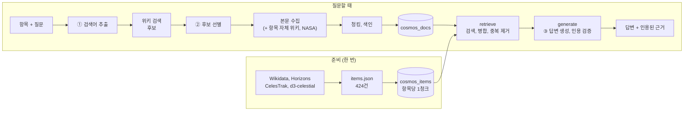
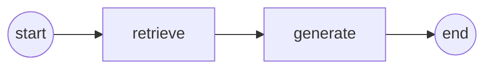
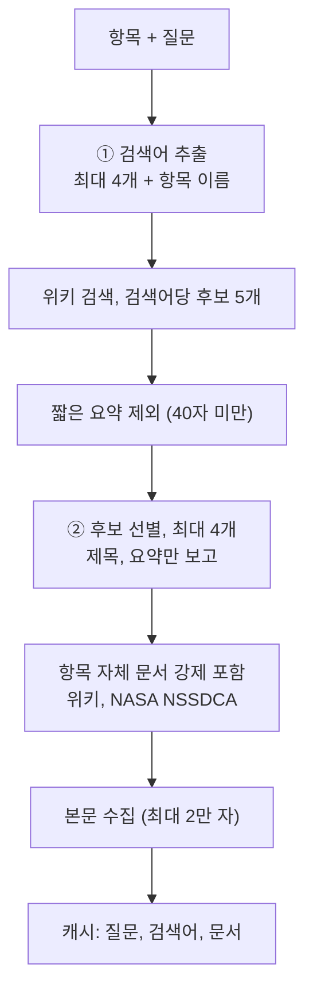
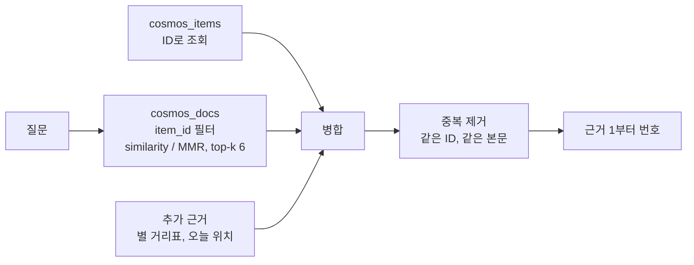
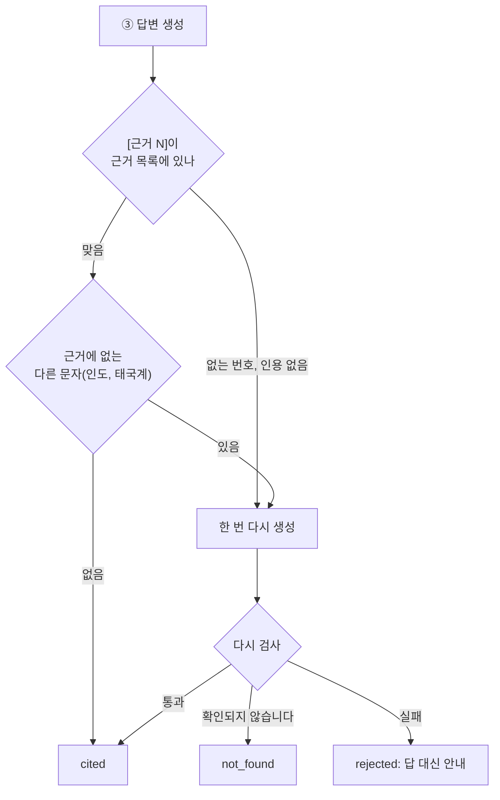

# 03. RAG 파이프라인 설계문서

> 항목 메타데이터와 외부 문서를 어떻게 모으고, 자르고, 색인하고, 찾아서 답하는지 정리합니다.
> 요구사항은 [02](02_requirements.md), 검증은 [04](04_verification.md)에 있습니다.
> 설정값은 모두 `config.toml` 한 곳에서 바꿉니다.

---

## 1. 전체 흐름

| 단계 | 코드 | 결과 |
|---|---|---|
| 항목 수집 | `scripts/collect_items.py` → `vasthorizon/data/items/` | `data/items.json` |
| 항목 색인 | `scripts/index_items.py` → `store/item_index.py` | `cosmos_items` |
| 문서 수집 | `collect/collector.py` (프롬프트 ① ②) | `data/cache/` |
| 문서 색인 | `store/chunking.py`, `store/doc_index.py` | `cosmos_docs` |
| 검색, 답변 | `rag/retrieval.py`, `rag/graph.py` (LangGraph) | 답변, 근거 |

LangGraph는 노드 두 개로 이루어져 있습니다 (`rag/graph.py`).

수집과 색인은 그래프에 들어가기 전에 처리합니다 (`rag/pipeline.ask`). 단계마다 진행 상태를 화면으로 보냅니다(SSE).

---

## 2. 컬렉션

Chroma 1.5.9를 쓰고, 저장소는 컬렉션마다 따로 둡니다(`data/chroma/<컬렉션>`). 임베딩 모델은 `text-embedding-3-small`입니다.

| 컬렉션 | 내용 | 청크 수 | 청크 ID |
|---|---|---:|---|
| `cosmos_items` | 항목 메타데이터 | 424 (항목당 1) | Wikidata QID: 예 `Q48469` |
| `cosmos_docs` | 외부 문서 (위키백과 639, NASA 18) | 657 (항목 22, 문서 68) | `항목ID:문서ID:순번` |
| `cosmos_perspective` | 관점 전환 서가 (위키 13문서) | 123 | `perspective:문서ID:순번` |

> 문서 청크 수는 2026-10-22 작성 시점 값입니다. 새 질문으로 문서를 수집할 때마다 늘어납니다 (화면 오른쪽 위에 상시 표시).
> 청크 ID가 고정되어 있어 다시 색인해도 쌓이지 않고 덮어씁니다. 본문 해시가 같으면 다시 임베딩하지 않습니다 (재색인 실측: 424 = 424, 다시 임베딩 0건).

### `cosmos_items` 메타데이터

| 필드 | 쓰임 |
|---|---|
| `item_id`, `name`, `name_en`, `wiki_title` | 식별, 문서 수집의 시작점 |
| `group`, `group_ko`, `kind`, `category` | 조건 탐색 필터, 화면 분류 |
| `source_type` (`항목 메타데이터`), `title`, `source_url` | 근거 표시 (Wikidata 링크) |
| `constellation`, `season`, `ecliptic`, `naked_eye`, `korean` | 조건 탐색 필터 |
| `distance_km`, `distance_ly`, `distance_approx`, `distance_reference` | 거리 조건, 내 세상 반지름 |
| `light_departure_year` | 빛의 편지, "빛이 출발한 해" 조건 |
| `text_hash` | 바뀐 항목만 다시 임베딩 |

항목 본문은 그룹별 속성을 문장으로 묶은 텍스트 1개입니다 (`data/item_text.py`). 거리에는 기준(지구 중심, 지표 고도, 기준일)을 함께 적습니다.

### `cosmos_docs` 메타데이터

| 필드 | 쓰임 |
|---|---|
| `item_id`, `item_name` | 그 항목 범위로만 검색 (필터) |
| `doc_id`, `title`, `section`, `seq` | 근거 제목 "문서 > 절" |
| `source_type` (`위키백과` / `NASA`), `license` | 출처 종류 표시 (F2016), 이용 조건 |
| `source_url`, `permalink`, `fetched_at`, `truncated` | 원문 링크, 수집 시점 판 |
| `role` (항목 문서 / 관련 문서), `query` | 왜 수집했는지 |
| `chunk_size`, `chunk_overlap` | 어떤 설정으로 잘랐는지 |

임베딩 모델과 차원은 컬렉션 메타데이터에 기록합니다. 다른 모델로 검색하려 하면 막습니다 (`store/chroma.check_identity`).

---

## 3. 수집

### 항목 메타데이터 (424건)

| 그룹 | 1차 출처 | 보강, 검증 |
|---|---|---|
| 태양계 32 | Wikidata | JPL Horizons: 기준일(2026-10-21) 위치, 지구 거리 |
| 인류의 발자취 100 | Wikidata | CelesTrak SATCAT (궤도, 운용 상태), Horizons (심우주 탐사선) |
| 별 94 | Wikidata | 거리를 **연주시차로 교차 검증** (가까운 별만, 아래 정책) |
| 메시에 110, 별자리 88 | Wikidata | d3-celestial (위치, 별자리 선) |

### 별 거리 정책

별 거리는 Wikidata 값을 쓰되, **연주시차(독립 측정)로 교차 검증할 수 있을 때만** 검증합니다 (`data/items/common.distance_with_parallax`).
연주시차가 작은(먼) 별은 측정 오차가 커서 기준으로 쓰지 않습니다.

| 경우 | 처리 | 이 거리의 성격 | 카탈로그 별 94 | 별자리 선의 별 756 |
|---|---|---|---:|---:|
| 연주시차 5mas 이상, 출처 값이 모두 1.5배 안 | 출처 값의 중앙값, 범위 | **교차 검증 완료** | 57 | 577 |
| 연주시차 5mas 이상, 일부 값만 1.5배 안 | 맞는 값만으로 중앙값, 범위, 뺀 값 수를 기록 | **교차 검증 완료** (어긋난 값 제외) | 0 | 16 |
| 연주시차 5mas 이상, 맞는 값 없음 | 연주시차로 계산 | 연주시차 계산값 | 2 | 7 |
| 출처 거리 값 없음 | 연주시차로 계산 (연주시차 크기와 무관) | 연주시차 계산값, 먼 별은 오차 큼 | 24 | 94 |
| 연주시차 5mas 미만 (약 650광년 너머) | 출처 값 그대로 | **출처 값, 교차 검증 미적용** | 7 | 62 |
| 연주시차 없음 | 출처 값 그대로 | **출처 값, 교차 검증 미적용** | 4 | 0 |

- 건수는 수집 캐시로 각 분기를 재현해 센 값입니다 (2026-10-22).
- 데이터 파일에는 `basis`(wikidata / parallax)와 `method`만 남습니다. '교차 검증 완료'와 '미적용'은 데이터 파일만으로는 구분할 수 없습니다.
- 그래서 문서와 화면에서는 '실제 거리'가 아니라 **카탈로그 거리**라고 부릅니다. 출처가 여럿이면 범위도 함께 보여 줍니다.

### 외부 문서 (질문할 때)

| 규칙 | 이유 |
|---|---|
| 본문을 받기 전에 제목, 요약으로 고릅니다 | 외부 호출과 임베딩을 줄입니다 |
| **항목 자체 문서는 어떤 제외 규칙보다 먼저** | 선별 프롬프트가 빼더라도 근거의 중심은 남습니다 |
| 이름만 같은 다른 주제는 버립니다 | "보이저"(노래) 같은 동음이의 |
| 같은 질문, 검색어, 문서는 캐시합니다 | 다시 물으면 LLM 0회, 새 문서 0건 (실측) |

실측: "제임스 웹은 어떤 빛으로 우주를 관측하나?"

| | 처음 | 두 번째 |
|---|---|---|
| 검색어 | 제임스 웹 우주망원경, 적외선, 근적외선, 중적외선 | (캐시 재사용) |
| 위키 검색 호출 | 3 | 0 |
| 후보 판정 | 색인 2 (자체 문서, 적외선), 기존 3, 제외 10 | 색인 0, 기존 5 |
| 새 문서 | 1 | 0 |

---

## 4. 청킹

`RecursiveCharacterTextSplitter`를 씁니다 (`store/chunking.py`). 출처마다 자르는 경계가 다릅니다.

| 출처 | 우선 경계 | 청크 머리말 |
|---|---|---|
| 위키백과 | 절 제목 → 문단 → 줄 → 문장 → 공백 | `[문서 > 절 > 하위 절]` |
| NASA (영문) | 문단 → 줄 → 문장(`. `) → 공백 | `[문서 제목]` |

- 머리말 덕분에 "목성 탐사"처럼 **절 이름에만 있는 단서**도 검색에 걸립니다.
- 머리말은 크기 계산에서 뺍니다 (본문만 `chunk_size` 이하).

### 크기, 겹침: 왜 1,000자 / 200자인가

같은 문서 묶음을 설정만 바꿔 가며 잘라 보았습니다 (캐시된 문서로 측정, 색인은 바꾸지 않음).

| 크기 / 겹침 | JWST 문서 8건 (81,417자) | 보이저 1호 문서 12건 (70,174자) | 평균 길이 |
|---|---:|---:|---:|
| 500 / 100 | 253 | 214 | 약 355자 |
| 1000 / 0 | 121 | 104 | 약 695자 |
| **1000 / 200** | **123** | **105** | **약 700자** |
| 1500 / 300 | 80 | 74 | 약 1,000~1,070자 |
| 2000 / 400 | 64 | 57 | 약 1,260~1,350자 |

| 관찰 | 판단 |
|---|---|
| 500자는 청크가 2배: 위키 한 문단(사실 + 맥락)이 갈라집니다 | 근거 하나로 답이 안 되는 경우가 늘어납니다 |
| 2000자는 한 청크에 절 여러 개 | 검색 정확도가 흐려지고 프롬프트가 길어집니다 |
| 1000자 ≈ 위키 한 절, 한두 문단 | 근거 1개 = 의미 1덩어리 |
| 겹침 0 → 200 차이는 청크 2개뿐 | 대부분 절 경계에서 잘리기 때문입니다. 그래도 긴 절이 문장 중간에서 끊기면 손실이 생기므로, 이를 막으려고 200을 둡니다 |

---

## 5. 검색, 병합

| 규칙 | 내용 |
|---|---|
| 근거 1 | 선택한 항목의 메타데이터 청크: **검색 없이 항상** |
| 문서 근거 | 그 항목 범위(`item_id`)에서만 검색합니다. 다른 천체 문서는 섞이지 않습니다 |
| 추가 근거 | 별자리 → 별들의 카탈로그 거리표, 태양계 천체와 심우주 탐사선 → 질문한 날의 Horizons 위치 |
| 중복 제거 | 같은 청크 ID, 그리고 본문이 같은 청크 (겹침 구간, 같은 문단 반복) |
| 장애 | 문서 검색이 실패하면 항목 근거만으로 답하고 경고합니다. 임베딩 모델이 다르면 검색하지 않습니다 |

### Top-k와 검색 방식: 왜 유사도, 6인가

"보이저 1호는 태양계를 벗어났나?"를 설정만 바꿔 가며 검색해 보았습니다.

| top-k | 유사도: 문서 종류 | MMR: 문서 종류 | 관찰 |
|---:|:-:|:-:|---|
| 3 | 2 | 2 | 유사도는 '태양권 탈출' 절 3개입니다. MMR에는 태양계 개론이 끼어듭니다 |
| **6** | **2** | 4 | 유사도에서는 태양권덮개, 성간매질 발견까지 들어와 답에 필요한 절이 모두 모입니다 |
| 10 | 3 | 4 | 유사도에 목성 탐사 등 질문과 먼 절이 섞입니다 |

- 기본값은 **유사도, 6**입니다. 사실 질문에서는 관련 절을 빠짐없이 모으는 편이 낫습니다.
- MMR을 쓰면 문서 종류는 넓어지지만, 점수가 낮은 개론 청크(0.35~0.40)가 들어옵니다.
- 탐색형 질문에 쓸 수 있도록 MMR을 설정으로 남겨 두었습니다 (`search_type = "mmr"`, fetch-k 30, λ 0.5).
- 둘을 나란히 비교하는 화면도 있습니다: Streamlit 'F2014' 탭 ([04 §5](04_verification.md)).

---

## 6. 프롬프트 세 개

모두 `rag/prompts.py`에 있습니다. 역할과 도메인 표현은 `data/domain.py`에서 가져옵니다.

| | ① 검색어 추출 (F2003) | ② 후보 선별 (F2004) | ③ 답변 생성 (F2007) |
|---|---|---|---|
| 역할 | 천문학 해설사 (도메인 전문가) | 같음 | 따뜻하고 차분한 천문학 해설사 |
| 입력 | 항목 요약, 질문 | 항목, 질문, 후보 (ID, 제목, 요약 300자) | 항목, 근거 목록, 질문, 이전 대화 3쌍 |
| 출력 | `{"queries": [...]}` | `{"selected": [...], "reason": ""}` | 본문 + `[근거 N]` |
| 핵심 규칙 | 위키 제목 같은 짧은 명사구, 항목 자체 문서는 따로 수집하니 **더 필요한 개념**을 고름 | 답이 있을 문서 → 핵심 개념 → 나머지 순, 동음이의 버림, 후보에 없는 ID 금지 | 근거만 사용, 사실 문장마다 번호, 없으면 "제공된 문서에서는 확인되지 않습니다"로 시작, 수치가 다르면 범위로, 기준일 함께 |

① 예시: "보이저 1호는 태양계를 벗어났나?" → `태양권계면`, `성간 매질`, `오르트 구름`

JSON 출력은 GMS의 JSON 모드로 받고 `rag/llm_json.py`에서 검사합니다. 형식이 깨지면 코드 블록과 앞뒤 설명을 걷어 내고 다시 파싱합니다. 그래도 실패하면 그 단계를 실패로 기록하고(캐시하지 않음) 항목 이름과 자체 문서만으로 이어 갑니다. 같은 질문을 다시 하면 실패한 단계부터 이어서 처리합니다.

### 특화 기능 프롬프트

| 기능 | 출력 | 검증 |
|---|---|---|
| 빛의 편지, 별자리 펼치기, 하늘 안내, 관점 전환 | 본문 + `[근거 N]` | ③과 같은 인용 검증 |
| 조건 필터 추출, 항목 선별 (F2011) | JSON | 필터 값은 허용 목록으로 다시 검사 |
| 관점 주제 분류 | `{"crisis", "themes", "query"}` | 위기 표현은 코드가 먼저 검사 → LLM은 2차 확인 |

---

## 7. 답변 검증과 근거 표시

| 상태 | 화면 |
|---|---|
| `cited` (인용 형식 통과) | 답 + **인용된 근거만** (번호, 제목 > 절, 출처 종류, 원문 링크, 발췌) |
| `not_found` | "제공된 문서에서는 확인되지 않습니다" + 근거로 확인되는 관련 사실 |
| `rejected` | 답을 보여 주지 않고 다시 물어보기 안내 |

- 제어 표식(`⟦END⟧`, `<|…|>`)만 지웁니다. 모델의 원본 응답은 `raw_answer`로 따로 남깁니다.
- 근거 목록에서는 항목 메타데이터와 외부 문서를 색과 꼬리표로 구분합니다 (F2016).

### 검증 범위: 무엇을 확인하고, 무엇을 확인하지 않나

| 범위 | 내용 | 강제 여부 |
|---|---|---|
| 프롬프트 규칙 (③) | 근거만 사용, 사실 문장마다 `[근거 N]`, 근거가 없으면 "확인되지 않습니다", 수치가 다르면 범위로 | 모델에게 요구할 뿐, 지켰는지는 아래 검사 범위만큼만 확인 |
| 자동 검사 (코드) | ① 근거 목록에 없는 번호 ② 사실을 답하면서 번호가 하나도 없음 ③ 근거에 없는 다른 문자(인도, 태국계) → 한 번 재생성 | `rag/citations.citation_issue`, `rag/graph.foreign_script_issue` |
| 자동 검사 안 함 | 주장과 인용한 근거 **내용의 의미 일치**, **모든** 사실 문장에 번호가 붙었는지 | 없음 |
| 사람 확인 | F2015 대표 질문 8문항 (실행 `52dd1b0c` 한 번) 주장과 근거 문서 대조 | [05 §2-1](05_rag_comparison.md) |

> **`cited`는 인용 형식 검사를 통과했다는 뜻입니다. 내용이 맞다는 보증이 아닙니다.**
> 예: 근거 1과 다른 내용의 문장에 `[근거 1]`을 붙여도 `citation_issue`는 통과시킵니다 (코드에 적힌 한계).
> 그래서 화면에서는 인용된 근거의 발췌와 원문 링크를 함께 보여 주어, 읽는 사람이 직접 대조할 수 있게 합니다.
> 의미 검증기는 만들지 않았습니다. 남은 과제입니다.

---

## 8. 도메인 특화 기능 설계 근거

| 기능 | 왜 이 도메인에 맞나 | 근거 데이터 |
|---|---|---|
| 빛의 편지 | 별빛은 과거에서 옵니다: 거리 = 시간. 수치가 틀리면 편지 전체가 거짓이 됩니다 | 거리 (출처 여러 개면 중앙값, 범위) + 그 해 위키 연도 문서 |
| 별자리 펼치기 | 별자리는 2D 착시입니다. 별마다 거리가 다르다는 것을 보여 주는 일이 가장 강한 '사실'입니다 | 별 거리표 (가까운 별은 연주시차로 교차 검증, §3) |
| 오늘 밤 나의 하늘 | 지식을 실제 관측으로 잇습니다 | 위치, 시각으로 계산한 고도, 방위표 (LLM은 계산하지 않음) |
| 관점 전환 | "당신의 세상은 생각보다 넓다": 위로를 지어내지 않고 우주의 사실로 | 큐레이션한 서가 13문서, 위기 안내 우선 |
| 내 세상 반지름 | 서비스의 약속을 숫자로: 지평선 4.7km에서 관측 가능한 우주까지 | 각 항목의 거리 |

---

## 9. 문제와 해결

| 문제 | 원인 | 해결 |
|---|---|---|
| 검색 중 1~2% 확률로 `Error finding id` | 로컬 Chroma에서 방금 쓴 컬렉션 검색 직전에 다른 컬렉션을 읽음 | 검색 순서를 바꿈 (각 500회 중 0회), 컬렉션마다 별도 저장소 |
| 다른 임베딩 모델로 만든 색인을 검색 | 설정만 바꾸고 재색인 안 함 | 컬렉션에 모델, 차원 기록 → 다르면 검색 거부 |
| 별 거리 값이 출처마다 수십 배 차이 | Wikidata에 단위, 대상이 잘못된 값 | 연주시차 5mas 이상인 별만 교차 검증해 1.5배 밖 값을 뺌, 맞는 값이 없으면 연주시차로 계산, 먼 별은 출처 값 그대로 (§3 별 거리 정책) |
| 5번 질문(오리온자리 별 거리) 확인 불가 | 별 거리표가 펼치기 화면에만 있고 질의응답 근거에 없음 | 별자리 질문에 거리표를 추가 근거로 |
| 답 끝에 `⟦END⟧`, 중간에 구자라트 문자 | 모델의 제어 표식, 다른 문자 섞임 | 표식만 제거, 다른 문자는 재생성 요청 (원어 인용은 보존) |
| 선별 프롬프트가 항목 자체 문서를 뺌 | "질문과 거리가 멀다"고 판단 | 자체 문서는 선별과 무관하게 강제 포함 |
| 별 `hip:1234` 캐시 파일 저장 실패 (Windows) | 파일 이름의 `:` | 파일 이름만 바꿔 저장 |
| 화면이 `.js`를 못 읽음 (Windows) | 레지스트리의 MIME이 `text/plain` | 서버에서 MIME을 직접 등록 |
| 같은 서랍에서 빠르게 연속 요청 | 늦게 온 이전 응답이 화면을 덮음 | 요청 순번, 최신 요청만 반영 (`web/js/flows.js`) |
| F2015 결과에 실행 조건이 섞임 | 부분 재실행 뒤 상위 정보만 바뀜 | 문항마다 실행 정보, 조건이 섞이면 경고 |

---

## 10. 설정 한눈에 (`config.toml`)

| 구역 | 값 |
|---|---|
| `[llm]` | `gpt-6-luna`, `text-embedding-3-small`, SSAFY GMS |
| `[chunking]` | `chunk_size 1000`, `chunk_overlap 200` |
| `[retrieval]` | `similarity`, `top_k_docs 6`, `mmr_fetch_k 30`, `mmr_lambda 0.5`, 조건 탐색 후보 20 |
| `[collect]` | 검색어 4, 검색어당 후보 5, 선별 4, 요약 최소 40자, 본문 200자~2만 자 |
| `[http]` | 호출 간격 0.5초, 재시도 4회, 제한 시간 30초 |
