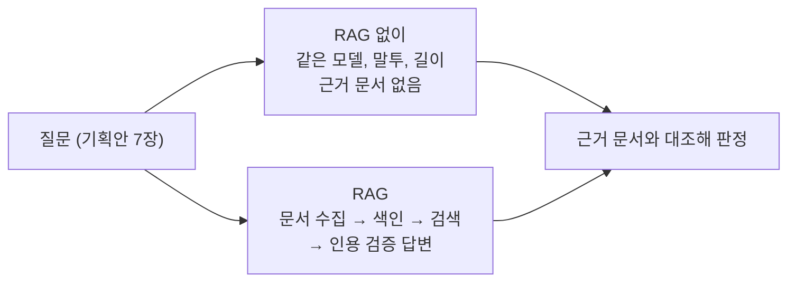

# 05. RAG 전후 품질 비교 (F2015)

> 같은 질문을 **근거 없이** 답하게 한 결과와 **RAG(근거와 함께)** 로 답한 결과를 나란히 비교합니다.
> 질문은 기획안 7장의 '근거가 필요한 질문' 8개입니다.

---

## 1. 비교 방법



| 항목 | 내용 |
|---|---|
| RAG 없이 | 같은 모델, 말투, 길이(3~6문장)로 묻되 근거 문서만 뺍니다 (`prompts.BASELINE_SYSTEM`) |
| RAG | 서비스 질의응답 전체: 위키 문서 수집, 색인, 검색, 인용 검증, 재생성 |
| 판정 | 답의 주장을 RAG가 수집한 근거 문서와 하나씩 대조 (사람 판정) |
| 원본 기록 | `data/eval/rag_comparison.json`: 문항마다 실행 정보, 원본 응답, 표시용 응답 |
| 다시 보기 | Streamlit 검증 페이지 'RAG 전후 비교' 탭: 질문별로 나란히, 실행 조건 함께 표시 |

> 두 쪽의 차이가 '근거의 유무' 하나로 좁혀지도록 모델, 말투, 길이를 맞췄습니다.
> 판정은 사람이 했고, 자동 지표(인용 수, 수치 개수)는 보조로만 씁니다.

### 이번 실행 (8문항 모두 한 번에, 같은 조건)

| 항목 | 값 |
|---|---|
| 실행 ID, 시각 | `52dd1b0c`, 2026-10-22 05:48 UTC |
| 모델, 임베딩 | `gpt-6-luna`, `text-embedding-3-small` |
| 검색 | 유사도 검색, top-k 6 (MMR 설정 fetch-k 30, λ 0.5) |
| 청킹 | 1,000자, 겹침 200자 |
| 프롬프트 지문, 코드 | `59f19a12a2c3`, `e0487db` + 작업 중 변경 |
| 조건 ID | `a953121316` (8문항 모두 같음) |

---

## 2. 결과 한눈에

| 판정 | 뜻 |
|---|---|
| **맞음** | 근거 문서로 확인됨 |
| **확인 불가(근거 부족)** | 질문은 충분하지만 수집한 근거에 답이 없음 |
| **확인 불가(입력 부족)** | 질문에 답하는 데 필요한 정보가 없음 |
| **근거 없음** | RAG 없이 답한 쪽의 주장은 서비스 안에서 확인할 수 없음 |

| # | 질문 | RAG 없이 | RAG | 판정 메모 |
|:-:|---|---|---|---|
| 1 | 아리랑 1호는 지금도 지구를 돌고 있나? | 그럴듯함, 근거 없음 | **맞음**, 인용 4 | RAG가 종료일 **2008년 2월 20일**을 근거로. RAG 없이는 "2008년쯤" |
| 2 | 제임스 웹 망원경은 허블처럼 지구를 도나? | 그럴듯함, 근거 없음 | **맞음**, 인용 3 | 비슷. RAG는 L2 헤일로 궤도, 태양 공전을 문서로 |
| 3 | 보이저 1호는 태양계를 벗어났나? | 그럴듯함, 기준 차이(오르트 구름)까지 설명 | **맞음**, 인용 5 | RAG가 **진입일 2012-08-25, 오늘 기준 거리 약 258억 km**. 단 '기준에 따른 차이'는 근거에 없어 빠짐 |
| 4 | 지금 보는 플레이아데스의 빛은 언제 출발했나? | 대략 맞음 ("16세기 말"), 근거 없음 | **맞음**, 인용 2 | RAG가 **1587년 무렵** (출처 3개 값 424~444광년의 중앙값) |
| 5 | 오리온자리 별들은 서로 가까이 모여 있나? | 그럴듯함, 수치 없음 | **맞음**, 인용 2 | RAG가 **26.2 ~ 5,285광년** 거리표를 근거로 |
| 6 (v2) | 점성술의 양자리 날짜(3월 21일~4월 19일)에 태양은 실제로 양자리 앞에 있나? | 구체 답 ("대부분 물고기자리"), 근거 없음 | **확인 불가(근거 부족)**, 인용 1 | 개념(점성술 별자리 ≠ 천문학 별자리, 세차 운동)은 근거로 설명. 그 날짜 태양의 실제 위치가 수집 문서에 없음 |
| 7 | 견우성과 직녀성은 실제로 얼마나 떨어져 있나? | 수치 단정 ("약 15광년"), 근거 없음 | **확인 불가(근거 부족)**, 인용 2 | 알타이르 거리(약 17광년)는 근거로. 두 별 사이 거리는 근거에 없음(질의응답 범위가 항목 하나) |
| 8 | 천상열차분야지도는 무엇을 담은 유물인가? | 그럴듯함, 근거 없음 | **맞음**, 인용 5 | RAG가 **별 1,467개, 별자리 283개**, 하단 기록 내용까지 문서로 |

| 지표 | RAG 없이 | RAG |
|---|---|---|
| 근거 인용 | 0회 (8문항 모두) | 문항당 1~5회 (모든 문항) |
| 출처를 확인할 수 없는 주장 | 모든 문항 | 인용한 주장은 모두 근거와 일치 (수동 대조, §2-1). 단 인용 없는 사실 문장이 2문항에 있습니다 |
| 확인 불가로 답함 | 0문항 | 2문항 (6, 7: 모두 근거 부족) |
| 응답 시간 (이번 실행) | 4~12초 | 5~26초 |

> 이번 실행에서 RAG 응답 시간이 짧은 것은 문서 대부분이 이미 수집된 상태였기 때문입니다.
> 문서를 처음 수집할 때는 12~58초가 걸렸습니다 (보관 결과, 3장).

> 이 판정은 **실행 `52dd1b0c` 한 번, 8문항**을 사람이 판정한 결과입니다. 다른 질문이나 다른 실행으로 일반화하지 않습니다.
> RAG 쪽 상태 `cited`는 인용 형식 검사를 통과했다는 뜻일 뿐입니다 ([03 §7](03_rag_pipeline_design.md) 검증 범위). 내용 대조는 아래 표에서 따로 했습니다.

### 2-1. 주장과 근거 대응 (수동 판정)

RAG 답의 핵심 주장마다, 인용한 근거 청크의 **전문**(화면 발췌 300자 밖 포함)에서 뒷받침하는 문장을 찾았습니다.

| # | RAG 답의 주장 | 인용 | 근거 속 문장 | 판정 |
|:-:|---|:-:|---|:-:|
| 1 | 현재 지구 궤도에 있다 | 1 | 항목: "현재 위치: 지구 궤도" | 일치 |
| 1 | 임무는 2008년 2월 20일 공식 종료 | 1, 4 | 위키 「아리랑 1호」: "2008년 2월 20일부로 임무를 공식 종료했다" (근거 1은 "운용 종료"만) | 일치 |
| 2 | L2 라그랑주점 주변 헤일로 궤도에서 운용 | 1, 6 | 항목: "지금 위치: 태양-지구 L2", 위키 「궤도 형태」: "L2 주변을 공전한다" | 일치 |
| 2 | 지구와 같은 주기로 태양을 돈다 | 6 | 「궤도 형태」: "지구와 같은 주기로 태양을 공전할 수 있다" | 일치 |
| 2 | "따라서 허블처럼 지구를 도는 망원경은 아닙니다" | 없음 | 앞 두 문장에서 끌어낸 결론 | **인용 없음** |
| 3 | 2012년 8월 25일 태양권계면을 넘어 성간 공간 진입, NASA가 태양계를 벗어났다고 발표 | 3, 7, 8 | 「보이저 계획 > 경과」: "2013년 9월, NASA는 … 2012년 8월 25일에 태양권덮개를 통과했으며, 공식적으로 태양계를 벗어났다고 발표" | 일치 |
| 3 | 2026-10-22 기준 지구에서 약 258억 km | 1, 2 | 오늘 위치 근거: "2026-10-22 기준 … 약 258억km" | 일치 |
| 4 | 약 1587년 무렵 출발, 약 439년 | 1 | 항목: "지금 보는 빛이 출발한 때: 1587년 무렵", "약 439광년 (출처 3개 값의 중앙값, 범위 424~444광년)" | 일치 |
| 5 | 같은 별자리여도 실제 공간에서 가깝지 않다 | 8 | 위키 「별자리」: "반드시 3차원 상으로 가까운 위치에 있는 것은 아니다" | 일치 |
| 5 | 선을 이루는 별 23개, 26.2 ~ 5,285광년 | 2 | 별 거리표: "가장 가까운 별: 타비트 약 26.2광년 · 가장 먼 별: χ2 오리온자리 약 5,285광년" | 일치 (거리 값은 카탈로그 값, [03 §3](03_rag_pipeline_design.md#별-거리-정책)) |
| 6 | 점성술의 양자리는 춘분점에서 시작하는 황도의 30도 구간 | (문단 끝 4) | 「점성술의 별자리」: "춘분점 … 에서 시작하는 황도의 30º씩의 열두 개의 구간" | 일치, **문장에 번호 없음** |
| 6 | 세차 운동 때문에 서로 대응하지 않는다 | (문단 끝 4) | 같은 문서: "세차 운동은 … 현 시대의 천문학상 별자리와 상응하지 않는 결과를 낳았다" | 일치, **문장에 번호 없음** |
| 6 | 3월 21일~4월 19일 태양의 실제 위치는 자료에 없다 | 4 | (근거에 없음을 밝힘) | 확인 불가 |
| 7 | 알타이르는 약 17광년, 베가와 여름의 대삼각형 | 1, 5 | 항목: "약 17광년", 위키 「베가 > 가시성」: "여름의 대삼각형 … 알타이르" | 일치 |
| 7 | 두 별 사이 거리는 제시되어 있지 않다 | 1, 5 | (근거에 없음을 밝힘) | 확인 불가 |
| 8 | 조선 초기부터 제작, 보급된 전천천문도, 태조 석각본 | 5, 7 | 위키 「천상열차분야지도」 첫 문단, 「개요」: "태조 4년(1395) … 비석에 다시금 새긴 것" | 일치 |
| 8 | 별 1,467개, 별자리 283개, 은하수, 적도, 황도 | 6 | 「형태」: "1467개의 별들이 283개의 별자리를 이루어 … 은하수가 그 모양대로 그려져" | 일치 |
| 8 | 해, 달, 절기별 별, 우주관, 28수, 내력, 관리 명단 | 6, 7 | 「형태」: "해·달·사방신 … 각 절기별 … 우주관, 측정된 28수의 거극도 … 참여한 서운관 관리들의 명단" | 일치 |

| 결과 | 내용 |
|---|---|
| 인용한 주장 | 모두 인용한 근거 문장과 일치 |
| 인용 없는 사실 문장 | 2번 결론 1문장, 6번 2문장 (번호가 문단 끝에만). 자동 검사는 "번호가 하나라도 있으면" 통과시키므로 여기서 걸러지지 않습니다 |
| 근거끼리 다른 값 | 8번 별 개수: 인용한 「형태」는 1,467개, 같은 항목의 다른 문서(「천상열차분야지도 각석 > 구성」)는 1,464개. 후자는 이번에 근거로 검색되지 않아서 답에 범위로 나오지 않았습니다 |

---

## 3. 실행 이력

| 실행 | 문항 | 상태 |
|---|---|---|
| 보관 `data/eval/archive/rag_comparison_20261022_145014.json` | 1~8 (6번 v1) | **이전 형식이라 비교 기준으로 쓰지 않음.** 두 번의 실행이 섞여 있고(2, 5번만 재실행) 문항별 실행 정보가 없습니다. 5번 답은 저장한 뒤에 답변 정리 규칙을 사후 적용해 고쳐 쓴 상태입니다 |
| 현재 `52dd1b0c` | 1~8 (6번 v2) | 8문항을 같은 조건에서 한 번에 실행. 이 문서의 판정 기준 |

### 6번 문항을 고친 이유

- v1 질문 "내 생일에 태양은 정말 내 '별자리'에 있었나?"에는 **생일 날짜도, 별자리 기준도 없었습니다.**
- 보관 결과의 RAG 답도 바로 그 점을 이유로 들었습니다: "생일 날짜와 기준으로 삼는 별자리가 제시되지 않아 … 판단할 수 없습니다".
- 즉 v1의 '확인 불가'는 **입력 부족** 때문이었습니다. 처음 보고서에서는 이를 '세차 운동 문서가 수집되지 않음'(검색 한계)으로 잘못 설명했습니다.
- v2는 날짜와 기준을 담은 일반 개념 질문으로 바꿨고, 버전을 올려 v1 결과와 섞이지 않게 했습니다.

---

## 4. 무엇이 달랐나

### RAG가 더 나았던 점

1. **검증할 수 있습니다.** RAG 답은 주장 대부분에 근거 번호가 붙어 있고, 번호를 따라 원문 링크로 갈 수 있습니다 (인용 없는 문장: 2번 1문장, 6번 2문장). 근거 없이 답한 쪽은 내용이 맞더라도 확인할 길이 없습니다.
2. **더 정확합니다.** 플레이아데스 빛의 출발 시점은 "16세기 말" → **1587년 무렵**. 아리랑 1호 종료일은 "2008년쯤" → **2008년 2월 20일**.
3. **지금의 값입니다.** 보이저 1호의 거리는 질문한 날 JPL Horizons로 계산한 값(2026-10-22 기준 약 258억 km)입니다.
4. **모르면 모른다고 합니다.** 6, 7번에서는 근거에 없는 부분을 "확인되지 않습니다"로 밝히고, 근거로 확인되는 부분만 답했습니다. 근거 없이 답한 쪽은 7번에서 "약 15광년"이라고 단정했는데, 실제 값에 가깝기는 해도 서비스 안에서는 확인할 수 없는 수치입니다.

### 근거 없이 답한 쪽이 나았던 점 (정직한 기록)

- **최신 모델은 근거 없이도 많이 알고 있었습니다.** 기획 단계에서 예상한 위험("아리랑 1호는 이미 추락했다"고 단정하는 등)은 나타나지 않았습니다.
- **3번의 '기준에 따라 답이 다르다'는 설명**(태양권계면 vs 오르트 구름)은 근거 없이 답한 쪽만 했습니다. RAG는 근거 범위 안에서만 답하기 때문에 근거에 없는 관점은 빠집니다.
- **6, 7번은 근거 없이 답한 쪽이 더 '쓸모 있어' 보입니다.** 다만 그 내용은 서비스가 보증할 수 없습니다. 지어내지 않는다는 VastHorizon의 원칙에 비추면 RAG의 '확인되지 않음'이 맞는 동작입니다.

> 결론: 이번 비교에서 RAG의 가치는 정답률보다 **신뢰할 수 있는 근거, 정확한 수치, 최신 값, 정직함**에서 드러났습니다.

---

## 5. 비교로 찾아 고친 것

| 발견 (보관 실행) | 원인 | 고친 것 |
|---|---|---|
| 5번이 '확인되지 않음' | 별자리 별들의 실제 거리(펼치기 화면의 데이터)가 질의응답 근거에 없었음 | 별자리 질문에 **별 거리표**를 근거로 추가 (`features/extra_evidence.py`, 재색인 없음): 이번 실행 5번에서 근거로 쓰임 |
| 답 끝에 `⟦END⟧` | 모델이 붙이는 제어 표식이 화면까지 나감 | 명확한 제어 표식만 제거 (`rag/graph.clean_reply`). 원본 응답은 `raw_answer`로 따로 보존 |
| 답 중간에 'એટલે'(구자라트 문자) | 모델이 다른 문자 조각을 섞음 | **근거에 없는 다른 문자가 섞이면 재생성을 요청**합니다. 재생성한 뒤에도 남아 있으면 답은 그대로 두고 경고를 붙입니다. 근거 속 원어 이름과 직접 인용은 건드리지 않습니다 |
| 결과 파일의 실행 정보 | 부분 재실행 뒤 최상위 모델, 시각만 바뀌어 한 번에 실행한 것처럼 보임 | 문항마다 실행 정보(모델, 검색, 청킹, 프롬프트 지문, 코드 버전), 부분 병합 시 보존, 조건이 섞이면 화면에 경고 |

> 처음에는 다른 문자를 문자권 단위로 지웠습니다. 그러면 근거에서 인용한 원어 이름까지 지워질 수 있어서 위와 같은 재생성 방식으로 바꿨습니다.

위 수정에는 모두 회귀 테스트가 있습니다 (`tests/test_rag_compare.py`).

---

## 6. 남은 한계

| 한계 | 예 | 앞으로 |
|---|---|---|
| 질의응답이 **항목 하나** 범위 | 7번: 알타이르와 베가 두 별의 거리 비교 | 질문에 나온 다른 천체(별칭 포함)의 항목 정보를 함께 근거로 |
| 근거에 계산이 필요한 사실이 없을 때 | 6번: 그 날짜 태양의 실제 위치 | 태양 위치 계산(하늘 기능에 이미 있음)을 근거로 추가 |
| 판정 문항 수 | 8문항, 판정용 1회 실행 | 문항을 늘리고 여러 번 실행해 편차를 볼 것 |
| 주장과 근거의 의미 일치를 자동 검사하지 않음 | 인용 형식만 검사, 문장마다 번호가 있는지도 보지 않음 (§2-1) | 문장 단위 인용 검사, 의미 대조(NLI 등) |
| 근거끼리 다른 값이 검색되지 않으면 한쪽 값만 답함 | 8번 별 1,467개 / 1,464개 | 같은 수치를 다룬 청크를 함께 찾는 검색 |

---

## 7. 다시 실행하기

```bash
python -m scripts.compare_rag              # 8문항 전체: 이전 결과는 data/eval/archive/에 보관
python -m scripts.compare_rag --only 5     # 일부만: 같은 (번호, 버전)만 바꾸고 나머지는 실행 정보째 둠
streamlit run app/streamlit_app.py         # 'RAG 전후 비교' 탭에서 나란히 보기
```

> 모델의 답은 실행할 때마다 조금씩 달라질 수 있습니다. 위 판정은 실행 `52dd1b0c`를 기준으로 합니다.
