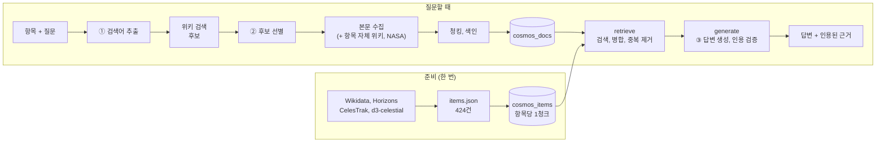
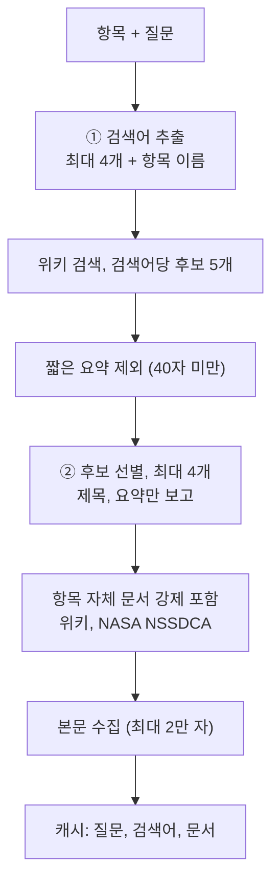
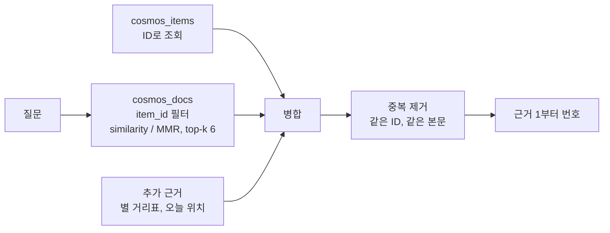
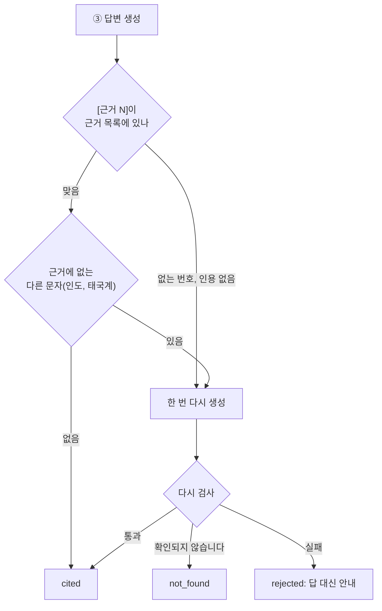

# 설계

> 항목 메타데이터와 외부 문서를 어떻게 모으고, 자르고, 색인하고, 찾아서 답하는지 정리합니다.
> 설정값은 모두 설정 파일 한 곳(`config.deploy.toml` 또는 `config.toml`)에서 바꿉니다.
> 설치와 실행 방법은 [setup.md](setup.md)에, 배포 방법은 [deploy.md](deploy.md)에 있습니다.

---

## 1. 전체 흐름

| 단계 | 코드 | 결과 |
|---|---|---|
| 항목 수집 | `scripts/collect_items.py` → `vasthorizon/data/items/` | `data/items.json` |
| 항목 색인 | `scripts/index_items.py` → `store/item_index.py` | `cosmos_items` |
| 검색어 추출, 후보 선별, 수집 | `collect/collector.py` (프롬프트 ① ②) | 문서 캐시 |
| 청킹, 색인 | `store/chunking.py`, `store/doc_index.py` | `cosmos_docs` |
| 검색, 답변, 인용 검증 | `rag/retrieval.py`, `rag/graph.py`, `rag/citations.py` | 답변, 근거 |

LangGraph 그래프는 `retrieve`와 `generate` 두 노드로 이루어져 있습니다(`rag/graph.py`).
수집과 색인은 그래프에 들어가기 전에 `rag/pipeline.ask`가 처리하며, 단계마다 진행 상태를 화면으로 보냅니다(SSE).

---

## 2. 컬렉션

벡터 데이터베이스는 Chroma를 쓰며, 컬렉션마다 저장소를 따로 둡니다(`<chroma_dir>/<컬렉션>`). 여러 컬렉션을 한 저장소에 함께 두었을 때 로컬 Chroma에서 검색 오류가 간헐적으로 생겼기 때문입니다.

| 컬렉션 | 내용 | 청크 ID |
|---|---|---|
| `cosmos_items` | 항목 메타데이터 424건 (항목당 1청크) | Wikidata QID (예: `Q48469`) |
| `cosmos_docs` | 질문하며 모은 외부 문서 (위키백과, NASA) | `항목ID:문서ID:순번` |
| `cosmos_perspective` | 관점 전환 서가 (위키 13문서, 123청크) | `perspective:문서ID:순번` |

- 청크 ID가 고정되어 있으므로 다시 색인해도 쌓이지 않고 덮어씁니다. 본문 해시가 같으면 다시 임베딩하지 않습니다.
- 임베딩 모델과 차원은 컬렉션 메타데이터에 기록합니다. 기록된 모델과 다른 모델로 검색하려고 하면 막습니다(`store/chroma.check_identity`).
- 문서 청크 수는 새 질문으로 문서를 모을 때마다 늘어나며, 화면 오른쪽 위에 표시됩니다.

### `cosmos_items` 메타데이터

| 필드 | 쓰임 |
|---|---|
| `item_id`, `name`, `name_en`, `wiki_title` | 식별, 문서 수집의 시작점 |
| `group`, `group_ko`, `kind`, `category` | 조건 탐색 필터, 화면 분류 |
| `source_type` (`항목 메타데이터`), `title`, `source_url` | 근거 표시 (Wikidata 링크) |
| `constellation`, `season`, `ecliptic`, `naked_eye`, `korean` | 조건 탐색 필터 |
| `distance_km`, `distance_ly`, `distance_approx`, `distance_reference` | 거리 조건, 내 세계의 반지름 |
| `light_departure_year` | 빛의 편지, "빛이 출발한 해" 조건 |
| `text_hash` | 바뀐 항목만 다시 임베딩 |

항목 본문은 그룹별 속성을 문장으로 묶은 텍스트 1개입니다(`data/item_text.py`). 거리에는 기준(지구 중심, 지표 고도, 기준일)을 함께 적습니다.

### `cosmos_docs` 메타데이터

| 필드 | 쓰임 |
|---|---|
| `item_id`, `item_name` | 그 항목 범위로만 검색 (필터) |
| `doc_id`, `title`, `section`, `seq` | 근거 제목 "문서 > 절" |
| `source_type` (`위키백과` / `NASA`), `license` | 출처 종류 표시, 이용 조건 |
| `source_url`, `permalink`, `fetched_at`, `truncated` | 원문 링크, 수집 시점의 판 |
| `role` (항목 문서 / 관련 문서), `query` | 그 문서를 수집한 이유 |
| `chunk_size`, `chunk_overlap` | 문서를 자를 때 쓴 설정 |

---

## 3. 수집

### 항목 메타데이터 (424건)

| 그룹 | 1차 출처 | 보강, 검증 |
|---|---|---|
| 태양계 32 | Wikidata | JPL Horizons: 기준일 위치, 지구까지의 거리 |
| 인류의 발자취 100 | Wikidata | CelesTrak SATCAT (궤도, 운용 상태), Horizons (심우주 탐사선) |
| 별 94 | Wikidata | 거리를 연주시차로 교차 검증 (아래 정책) |
| 메시에 110, 별자리 88 | Wikidata | d3-celestial (위치, 별자리 선) |

### 별 거리 정책

별 거리는 Wikidata 값을 쓰며, 연주시차(독립 측정)로 교차 검증할 수 있는 별만 검증합니다(`data/items/common.distance_with_parallax`).
연주시차가 작은(먼) 별은 측정 오차가 커서 기준으로 쓰지 않습니다.

| 경우 | 처리 | 카탈로그 별 94 | 별자리 선의 별 756 |
|---|---|---:|---:|
| 연주시차 5mas 이상, 출처 값이 모두 1.5배 안 | 출처 값의 중앙값과 범위 (교차 검증 완료) | 57 | 577 |
| 연주시차 5mas 이상, 일부 값만 1.5배 안 | 맞는 값만으로 중앙값과 범위, 뺀 값 수를 기록 | 0 | 16 |
| 연주시차 5mas 이상, 맞는 값 없음 | 연주시차로 계산 | 2 | 7 |
| 출처 거리 값 없음 | 연주시차로 계산 (먼 별은 오차가 큼) | 24 | 94 |
| 연주시차 5mas 미만 (약 650광년 너머) | 출처 값 그대로 (교차 검증 미적용) | 7 | 62 |
| 연주시차 없음 | 출처 값 그대로 (교차 검증 미적용) | 4 | 0 |

데이터 파일에는 `basis`(wikidata / parallax)와 `method`만 남습니다. 그래서 문서와 화면에서는 '실제 거리'가 아니라 **카탈로그 거리**라고 부르고, 출처가 여럿이면 범위도 함께 보여 줍니다.

### 외부 문서 (질문할 때)

| 규칙 | 이유 |
|---|---|
| 본문을 받기 전에 제목과 요약으로 고릅니다 | 외부 호출과 임베딩을 줄이기 위해서입니다 |
| 항목 자체 문서는 어떤 제외 규칙보다 먼저 포함합니다 | 선별 프롬프트가 빼더라도 근거의 중심은 남아야 합니다 |
| 이름만 같은 다른 주제는 버립니다 | "보이저"(노래) 같은 동음이의 문서를 막습니다 |
| 같은 질문, 검색어, 문서는 캐시합니다 | 다시 물으면 LLM 호출과 새 문서가 모두 0건입니다 |

검색, 선별, 본문 수집이 실패하면 그 단계를 완료로 기록하지 않습니다. 같은 질문을 다시 하면 실패한 단계부터 이어서 처리합니다.

---

## 4. 청킹

문서를 자를 때는 `RecursiveCharacterTextSplitter`를 씁니다(`store/chunking.py`). 출처마다 자르는 경계가 다릅니다.

| 출처 | 우선 경계 | 청크 머리말 |
|---|---|---|
| 위키백과 | 절 제목 → 문단 → 줄 → 문장 → 공백 | `[문서 > 절 > 하위 절]` |
| NASA (영문) | 문단 → 줄 → 문장(`. `) → 공백 | `[문서 제목]` |

청크에 머리말을 붙이므로 "목성 탐사"처럼 절 이름에만 있는 단서도 검색됩니다. 청크 크기를 계산할 때 머리말은 빼고 셉니다.

### 크기와 겹침: 왜 1,000자 / 200자인가

같은 문서 묶음을 설정만 바꿔 가며 잘라 보았습니다.

| 크기 / 겹침 | JWST 문서 8건 (81,417자) | 보이저 1호 문서 12건 (70,174자) | 평균 길이 |
|---|---:|---:|---:|
| 500 / 100 | 253 | 214 | 약 355자 |
| 1000 / 0 | 121 | 104 | 약 695자 |
| **1000 / 200** | **123** | **105** | **약 700자** |
| 1500 / 300 | 80 | 74 | 약 1,000~1,070자 |
| 2000 / 400 | 64 | 57 | 약 1,260~1,350자 |

| 관찰 | 판단 |
|---|---|
| 500자에서는 청크가 2배로 늘고 위키 한 문단(사실과 맥락)이 갈라집니다 | 근거 하나로 답할 수 없는 경우가 늘어납니다 |
| 2,000자에서는 한 청크에 절이 여러 개 들어갑니다 | 검색 정확도가 흐려지고 프롬프트가 길어집니다 |
| 1,000자는 위키 한 절, 곧 한두 문단과 비슷합니다 | 근거 하나가 의미 하나와 맞습니다 |
| 겹침 0과 200의 차이는 청크 2개뿐입니다 | 대부분 절 경계에서 잘리기 때문입니다. 긴 절이 문장 중간에서 끊길 때 생기는 손실을 막으려고 200을 둡니다 |

---

## 5. 검색과 병합

| 규칙 | 내용 |
|---|---|
| 근거 1 | 선택한 항목의 메타데이터 청크를 검색 없이 항상 넣습니다 |
| 문서 근거 | 그 항목 범위(`item_id`)에서만 검색하므로 다른 천체의 문서는 섞이지 않습니다 |
| 추가 근거 | 별자리에는 별들의 카탈로그 거리표를, 태양계 천체와 심우주 탐사선에는 질문한 날의 Horizons 위치를 넣습니다 |
| 중복 제거 | 청크 ID가 같거나 본문이 같은 청크를 하나로 합칩니다 |
| 장애 | 문서 검색이 실패하면 항목 근거만으로 답하고 경고합니다. 임베딩 모델이 다르면 검색하지 않습니다 |

### Top-k와 검색 방식: 왜 유사도 6인가

"보이저 1호는 태양계를 벗어났나?"를 설정만 바꿔 가며 검색해 보았습니다.

| top-k | 유사도: 문서 종류 | MMR: 문서 종류 | 관찰 |
|---:|:-:|:-:|---|
| 3 | 2 | 2 | 유사도는 '태양권 탈출' 절 3개를 찾습니다. MMR에는 태양계 개론이 끼어듭니다 |
| **6** | **2** | 4 | 유사도에서 태양권덮개와 성간매질 발견 절까지 들어와, 답에 필요한 절이 모두 모입니다 |
| 10 | 3 | 4 | 유사도에 목성 탐사처럼 질문과 먼 절이 섞입니다 |

사실 질문에서는 관련 절을 빠짐없이 모으는 편이 낫기 때문에 기본값을 **유사도, 6**으로 정했습니다.
MMR은 문서 종류를 넓히지만 점수가 낮은 개론 청크가 들어오므로, 탐색형 질문용 설정으로만 남겼습니다(`search_type = "mmr"`, fetch-k 30, λ 0.5).

---

## 6. 프롬프트

모든 프롬프트는 `rag/prompts.py`에 있고, 역할과 도메인 표현은 `data/domain.py`에서 가져옵니다.

| | ① 검색어 추출 | ② 후보 선별 | ③ 답변 생성 |
|---|---|---|---|
| 입력 | 항목 요약, 질문 | 항목, 질문, 후보 (ID, 제목, 요약 300자) | 항목, 근거 목록, 질문, 이전 대화 3쌍 |
| 출력 | `{"queries": [...]}` | `{"selected": [...], "reason": ""}` | 본문 + `[근거 N]` |
| 핵심 규칙 | 위키 제목 같은 짧은 명사구, 항목 자체 문서 외에 더 필요한 개념을 고름 | 답이 있을 문서를 먼저 고르고, 동음이의 문서와 후보에 없는 ID는 버림 | 근거만 사용, 사실 문장마다 번호, 근거가 없으면 "제공된 문서에서는 확인되지 않습니다"로 시작 |

JSON 응답은 `rag/llm_json.py`에서 검사합니다. 형식이 깨지면 코드 블록과 앞뒤 설명을 걷어 내고 다시 읽습니다. Claude가 고친 JSON을 한 번 더 내놓으면 마지막 객체를 씁니다.
그래도 읽지 못하면 그 단계를 실패로 기록하고(캐시하지 않음) 항목 이름과 자체 문서만으로 이어 갑니다.

---

## 7. 답변 검증과 근거 표시

| 상태 | 화면 |
|---|---|
| `cited` | 답과 함께 인용된 근거만 보여 줍니다 (번호, 제목 > 절, 출처 종류, 원문 링크, 발췌) |
| `not_found` | "제공된 문서에서는 확인되지 않습니다"와 근거로 확인되는 관련 사실을 보여 줍니다 |
| `rejected` | 답을 보여 주지 않고 다시 물어보기를 안내합니다 |

> **`cited`는 인용 형식 검사를 통과했다는 뜻이며, 내용이 맞다는 보증은 아닙니다.**
> 코드는 근거 목록에 없는 번호, 번호가 하나도 없는 사실 답변, 근거에 없는 다른 문자만 검사합니다. 주장과 근거 내용이 의미상 일치하는지는 검사하지 않습니다.
> 그래서 화면은 인용된 근거의 발췌와 원문 링크를 함께 보여 주어, 읽는 사람이 직접 대조할 수 있게 합니다.

---

## 8. 조건 탐색과 이름 질의

조건 탐색(`features/explore.py`)은 "맨눈으로 볼 수 있는 은하"처럼 확인할 수 있는 조건으로 천체를 찾습니다.

| 질의 | 처리 |
|---|---|
| 조건 ("100광년 안의 밝은 별") | 숫자와 참거짓 조건은 의미 검색이 약하므로, LLM이 필터로 바꾸고 검색 단계에서 먼저 거릅니다. 선별 결과에서 후보에 없는 ID는 버립니다 |
| 이름만 ("베가", "베텔게우스와 시리우스") | 질문이 카탈로그 천체 이름만으로 이루어져 있으면 LLM을 부르지 않고 그 천체 카드를 돌려줍니다 |
| 성군 ("여름 삼각형", "북두칠성") | 카탈로그에는 성군 항목이 없으므로, 별칭 표(`data/asterisms.py`)로 구성 천체를 찾아 카드로 보여 줍니다. 표에 없는 묶음은 필터 추출 응답의 구성 천체 이름을 카탈로그와 대조합니다 |
| 특정 천체의 사실 ("안드로메다 은하 가운데 블랙홀 이름은?") | 조건으로 바꿀 수 없는 질문이므로 `status="ask"`를 돌려주고, 화면은 그 천체에게 같은 질문을 하는 버튼을 보여 줍니다 |

### 규칙 선해석과 결정적 경로

- 질의는 먼저 동의어 표(`features/explore_rules.py`)로 해석합니다. 표가 모든 낱말을 해석하면 필터 추출 LLM을 부르지 않고, 일부만 해석하면 LLM이 비워 둔 필드에만 표의 해석을 합칩니다. 애매한 낱말이 남거나 "않", "없" 같은 부정어가 긍정 규칙 바로 뒤에 오면 LLM이 해석합니다.
- 표로 완전히 해석된 질의("블랙홀이 발견된 천체", "고리가 있는 행성")는 데이터만으로 결과가 정해집니다. 이 결정적 경로는 필터 추출 LLM과 선별 LLM을 모두 건너뛰므로 LLM을 한 번도 부르지 않고, 호출 한도도 소비하지 않습니다.
- "가장 가까운 별"처럼 정렬이 필요한 질의는 의미 검색 상위 후보가 아니라, 필터에 맞는 카탈로그 전체를 정렬해서 상위 몇 건을 고릅니다. 정답이 후보 밖에 있어 결과에서 빠지던 문제를 막기 위해서입니다.
- 선별 LLM을 부를 때는 후보의 색인 텍스트를 필요한 메타데이터만 남긴 짧은 텍스트로 압축해서 넘깁니다(`compact_item_text`). 프롬프트가 짧아져 입력 토큰이 줄어듭니다.

### 카탈로그 보강

수집한 메타데이터에 사실 데이터를 덧붙이는 파일은 `vasthorizon/data/enrich.json`이고, 이 파일은 `scripts/enrich_items.py`로 만듭니다. 값마다 출처를 함께 남기며, 수집하고 색인할 때 `vasthorizon/data/enrich.py`가 이 값을 메타데이터에 합칩니다. 보강하는 항목은 다음과 같습니다.

| 항목 | 내용 |
|---|---|
| 블랙홀 | 블랙홀이 발견된 천체인지 여부 |
| 고리 | 고리가 있는 행성인지 여부 |
| 위성 수 | NASA 행성 자료표의 값입니다. 새 위성이 발견되면 달라질 수 있습니다 |
| 탐사선 방문 | 탐사선이 방문한 적이 있는지 여부 |
| 서울 관측 | 파일에 적지 않고 적위로 계산해서 서울에서 볼 수 있는지 판단합니다 |

---

## 9. 기능별 데이터 출처

| 기능 | 근거 데이터 | LLM의 역할 |
|---|---|---|
| 천체 질의응답 | 항목 메타데이터(근거 1) + 그 천체 범위의 위키백과, NASA 문서 | 근거만으로 답하고 인용합니다 |
| 천체 이야기 | 자체 위키 문서의 첫머리와 역사 절 발췌 (`/api/items/{id}/intro`) | 쓰지 않습니다 |
| 내 세계 | 각 항목의 카탈로그 거리. 알아간 빛의 기록은 브라우저에만 저장합니다 | 쓰지 않습니다 |
| 빛의 편지 | 거리(출처가 여럿이면 중앙값과 범위) + 그해 위키 연도 문서 | 인용 검증을 거친 편지를 씁니다 |
| 별자리 펼치기 | 별자리 선의 별 756개와 카탈로그 거리표 | 거리표를 인용해 설명합니다 |
| 오늘 밤 나의 하늘 | 위치와 시각으로 코드가 계산한 별자리, 행성의 고도와 방위 | 계산 결과로 안내문만 씁니다 (계산은 하지 않습니다) |
| 관점 전환 | 큐레이션한 서가 13문서(`data/perspective_library.py`) | 위기 표현은 코드가 먼저 검사하고, LLM은 2차 확인과 서가 인용 답변을 맡습니다 |
| 3D 하늘 | d3-celestial 별 118,216개, 성운, 성단, 은하 15,809개, 은하수. 태양, 달, 행성은 `web/js/ephemeris.js`가 JPL 근사 궤도 요소로 계산합니다 | 쓰지 않습니다 |
| 태양계 천체 근접 뷰 | 탐사선과 관측으로 알려진 특징, 공개된 평균 반지름이나 세 축 크기 | 쓰지 않습니다 (절차적으로 그린 상상도입니다) |

---

## 10. 설정 한눈에

| 구역 | 값 |
|---|---|
| `[llm]` | 배포 기본: Claude(`claude-sonnet-5-5`) + 로컬 임베딩(`paraphrase-multilingual-MiniLM-L12-v2`) |
| `[chunking]` | `chunk_size 1000`, `chunk_overlap 200` |
| `[retrieval]` | `similarity`, `top_k_docs 6`, `mmr_fetch_k 30`, `mmr_lambda 0.5`, 조건 탐색 후보 20 |
| `[collect]` | 검색어 4, 검색어당 후보 5, 선별 4, 요약 최소 40자, 본문 200자~2만 자 |
| `[http]` | 호출 간격 0.5초, 재시도 4회, 제한 시간 30초 |
| `[limits]` | 사용자별 1분 6회, 하루 60회, 서버 전체 하루 1,500회 (배포 설정에서만 켭니다) |

---

## 11. 비용과 응답 캐시

### 모델 분리

| 용도 | 모델 | effort |
|---|---|---|
| 구조화(검색어 추출, 후보 선별, 조건 탐색 필터, 마음 한 줄 분류) | Haiku (`anthropic_fast_model`) | `low` |
| 답변(질의응답, 편지, 마음 한 줄 답, 별자리 펼치기, 하늘 안내) | Sonnet (`anthropic_model`) | `medium` |

짧은 JSON만 만드는 단계는 저렴한 모델로 처리하고, 사용자에게 보이는 글만 답변 모델로 씁니다.

### 응답 캐시

같은 요청이 다시 들어오면 LLM을 부르지 않고 저장한 응답을 돌려줍니다(`vasthorizon/cache.py`). 모델, effort, 프롬프트 파일, 항목 카탈로그가 바뀌면 캐시 키가 달라지므로 예전 응답은 쓰이지 않습니다.

| 대상 | 보관 기간 | 비고 |
|---|---|---|
| 조건 탐색 결과 | 7일 | |
| 빛의 편지 | 7일 | 항목별입니다. 나이로 찾은 별도 같은 항목이면 같은 편지를 씁니다 |
| 별자리 펼치기 설명 | 30일 | |
| 마음 한 줄 답 | 1일 | 키는 문장의 해시입니다 |
| 질의응답 답변 | 7일 | 대화 기록이 없는 첫 질문만 저장합니다 |
| 실시간 위치나 거리가 들어간 답변 | 1일 | 근거에 오늘 기준 값이 들어간 답변입니다 |

캐시에 적중한 응답은 호출 한도와 하루 예산을 쓰지 않습니다. 캐시에서 꺼낸 응답에는 `cached: true`가 표시됩니다.

마음 한 줄 캐시는 문장의 해시를 키로 씁니다. 그러나 저장하는 응답에는 사용자가 쓴 본문이 들어 있으므로, 그 본문이 1일 동안 서버 디스크(`data/cache/responses`)에 남습니다. 이 폴더에는 개인정보가 담길 수 있으므로, 운영자는 이 폴더를 외부에 노출하거나 백업하지 않도록 관리해야 합니다.

### 사용량 기록과 하루 예산

LLM을 부를 때마다 모델, 용도, 토큰 수, 소요 시간, 추정 비용을 `data/cache/usage.jsonl`에 JSONL 한 줄로 기록합니다. 프롬프트와 응답 본문은 기록하지 않습니다. 오늘(한국 시각) 합계는 `/api/health`의 `usage`에서 확인합니다. 추정 비용이 `[limits] daily_cost_usd`를 넘으면 새 LLM 호출을 막습니다. 이 예산은 호출 한도(`enabled`)와 별개로 항상 적용됩니다.
